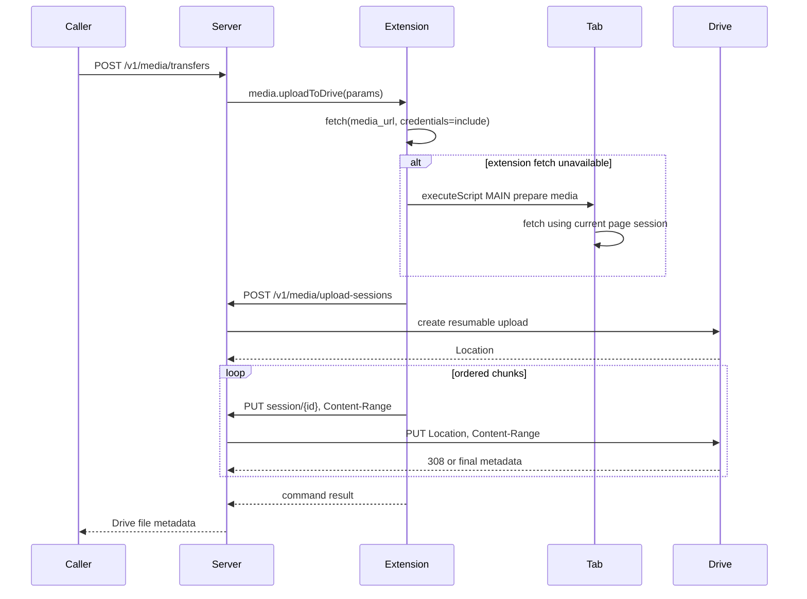

# DESIGN-002: Browser media chunk upload to Google Drive

## 1. Context & Scope

### Problem Statement

Social media APIs and CDN URLs can require the user's current browser session. Sending those cookies to a backend creates account-takeover risk and may still fail because anti-bot state is bound to the browser. The system needs to acquire bytes in Chrome, upload them in bounded chunks, and let the backend own Google Drive OAuth and resumable delivery.

Success means a caller can request one browser-accessible media URL and receive final Drive file metadata without the server writing a temporary media file or receiving social credentials.

### Context Loaded

- `extension/background.js`, `extension/protocol.js`, `extension/manifest.json`
- `server/internal/bridge/server.go`, protocol and tests
- `social_media_download` reversed Instagram/TikTok request and download flows
- Architecture, API, SDD, requirements, deployment and quality standards

### Brownfield Scope

- Touched modules: extension command dispatcher; Go HTTP router; new Drive client/session manager; startup configuration.
- Direct dependencies: Chrome `scripting`, cross-origin `fetch`, WSS shared token, Google OAuth token endpoint and Drive v3 resumable API.
- Contracts affected: capability list, command params/result, HTTP endpoints, environment variables.
- Known unknowns: platform-specific CDN CORS behavior and real Google OAuth consent configuration require UAT.
- Scope expansion: docs and ADR are required because security, API and deployment boundaries change.

### Small Task Exemption

No. This changes API, security and runtime behavior. Owner approved the selected chunk-upload approach on 2026-08-20.

## 2. Design Considerations & Trade-offs

| Alternative | Pros | Cons | Decision |
| --- | --- | --- | --- |
| Send social cookies to backend and let backend download | Simple extension | High credential risk; device/IP binding; cookies leak into logs | Rejected |
| Buffer full media as Base64 in WSS | One transport | 33% expansion, 1 MiB protocol limit, MV3 memory pressure | Rejected |
| Save chunks to backend temp file, then upload Drive | Easy retry/restart reasoning | Doubles I/O and disk footprint; retains user media | Rejected for MVP |
| Proxy ordered raw chunks into Drive resumable session | Bounded memory, no temp media, Drive retry semantics | Session state is in-memory; ordered chunks only | Chosen |
| Extension uploads directly to Drive | Removes backend data path | Exposes Drive token to extension and duplicates OAuth lifecycle | Rejected |

## 3. Architecture Overview

```text
+---------------- Chrome tab ----------------+
| page session/cookies -> fetch media bytes  |
+--------------------+------------------------+
                     | chunk bytes only
                     v
+------------- MV3 service worker ------------+
| command dispatcher | chunk reader | HTTP   |
+--------------------+------------------------+
                     | Bearer token + raw chunk
                     v
+---------------- Go backend -----------------+
| transfer route | session validation | Drive proxy |
+--------------------+------------------------+
                     | OAuth + Content-Range
                     v
+----------- Google Drive resumable API ------+
| upload session -> final Drive file metadata |
+---------------------------------------------+
```

### Component Responsibilities

| Component | Role |
| --- | --- |
| Extension dispatcher | Validate command, select tab and report final result/error |
| Media source reader | Fetch directly first; use tab `MAIN` world fallback; expose bounded chunks |
| Backend session manager | Authenticate, enforce total size/range/order, hold short-lived Drive session URL in memory |
| Drive client | Refresh Google access token, create resumable session and upload one chunk |
| Transfer HTTP route | Start extension command with a long deadline for non-MCP/manual use |

## 4. Execution Flow



Failure handling:

1. Failed session creation returns before any media chunk is sent.
2. Backend accepts only `start == next_offset`; retrying an already accepted chunk returns an offset conflict rather than duplicating bytes.
3. Drive `308` advances the offset. Final `200/201` marks the session complete.
4. Session state expires in memory and is lost on process restart; caller retries the whole transfer.

## 5. API & Data Model Design

### WSS Method

`media.uploadToDrive` params:

```json
{
  "media_url": "https://cdn.example/media.mp4",
  "filename": "post-123.mp4",
  "mime_type": "video/mp4",
  "drive_folder_id": "optional-folder-id",
  "tab_id": 123
}
```

Result contains `id`, `name`, `mime_type`, `size` and optional `web_view_link` returned by Drive.

### HTTP API

- `POST /v1/media/transfers`: authenticated caller asks server to dispatch the WSS command.
- `POST /v1/media/upload-sessions`: extension creates a Drive resumable session with filename, MIME type, total size and optional folder.
- `PUT /v1/media/upload-sessions/{id}`: extension sends raw bytes with `Content-Range: bytes start-end/total`.
- `GET /v1/media/upload-sessions/{id}`: returns current offset/status without exposing the Google session URL.

### Data Model

In-memory session fields: random ID, Google upload URL, filename, MIME type, total size, next offset, status, final file metadata, created/updated timestamps. No schema migration.

## 6. Security & Authorization

- All Browser Bridge HTTP and WSS paths use the existing shared bearer token.
- The shared token is passed only in extension-isolated/service-worker context, never as an argument to `MAIN` world code.
- Tab code receives media URL and a random ephemeral key only. It returns bytes, size and MIME type.
- Social cookies remain managed by Chrome and are never serialized to WSS/HTTP/storage/logs.
- Google client secret/refresh token remain backend environment secrets.
- Filename, URL scheme, tab ID, total size, MIME type, Content-Range and chunk size are validated.
- No DRM, CAPTCHA, paywall or access-control bypass is attempted; Chrome must already be authorized to fetch the media.

## 7. Implementation & Verification Plan

### Impacted Areas

- Code: extension worker/protocol/manifest; bridge handlers; Drive OAuth/upload package; main config.
- Product: one media URL can be transferred to Drive.
- API: one WSS method and four HTTP operations.
- Data: ephemeral memory only.
- Deployment: Google OAuth environment variables and outbound HTTPS required.
- Docs: requirements, API, architecture, SDD, integrations, deployment, context and validation matrix.

### Test Plan

- Unit: OAuth response handling, Drive session response/status parsing, Content-Range parser.
- Integration: fake Drive client verifies create, sequential chunks, completion, auth and invalid ranges.
- Extension: `node --check`; real Chrome UAT for service-worker and `MAIN` world fallback.
- UAT: upload a public media URL, then an authenticated social URL, compare final Drive size.

### Validation Matrix Impact

Update required: add browser media -> backend chunk -> Drive row; automated integration plus pending Chrome/Drive UAT.

### Verification Results

- Backend code added in `server/internal/drive` and `server/internal/bridge`.
- Extension code added in `extension/background.js`, `extension/protocol.js` and `extension/manifest.json`.
- Automated checks passed on 2026-08-20:
  - `rtk env GOCACHE=/private/tmp/browserbridge-go-cache go test ./...`
  - `rtk node --check extension/background.js`
- Real Chrome/Google Drive UAT is intentionally not marked complete until owner credentials are configured.

## 8. Reconciliation Plan

- Requirements: add browser-session media transfer requirement and credential boundary NFR.
- Architecture/API/SDD: update runtime components and contracts.
- ERD: no change because sessions are not persisted.
- ADR: add ADR-002 for the cookie/Drive trust boundary and no-temp-file choice.
- Context, traceability, phase and validation matrix: update.
