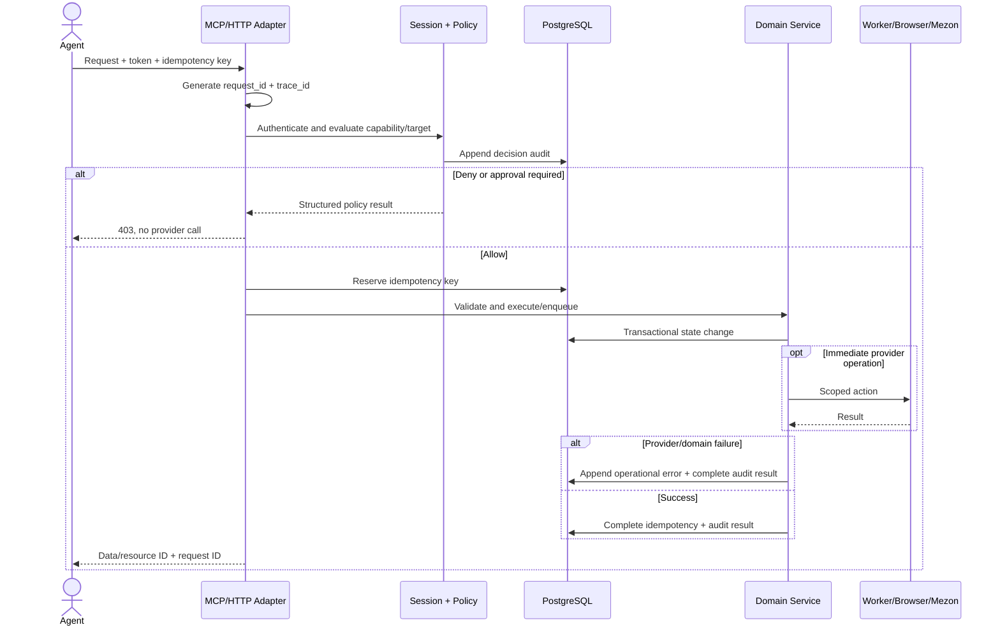

# DESIGN-004 Agent HTTP API, MCP, permission, and audit contract

> **Deferred on 2026-08-24 by [ADR-005](../../decisions/ADR-005-single-scope-api-keys-with-redis-cache.md).**
> The normative agent contract for the current deployment is
> [DESIGN-006](DESIGN-006-agent-api-key-and-read-api.md). Nothing in this annex is
> implemented. Where the two documents disagree, DESIGN-006 wins until this one is
> reactivated.

This annex is normative for TICKET-011. Email and arbitrary external API connectors remain future work; browser, social/media and mlem bot control are fully specified here.

## 1. API boundary and compatibility

- Public control plane stays under `/v1` for additive endpoints.
- Existing `BROWSER_BRIDGE_AUTH_TOKEN` continues to authenticate legacy browser/extension routes only during `personal_legacy` compatibility mode.
- New agent routes require a gateway session token. A legacy shared token must not call agent policy, audit or job mutation endpoints.
- Internal extension WSS remains protocol v1. Gateway translates agent operations to existing BrowserBridge HTTP/WSS commands.
- JSON request limit is 1 MiB unless a media chunk endpoint has its existing bounded raw-body limit.
- All timestamps are RFC 3339 UTC; UUIDs are lowercase canonical strings.

## 2. Authentication lifecycle

### Bootstrap

One local bootstrap command creates or rotates agent `owner-local` and prints a session token once. The plaintext token is never stored. The database stores `SHA-256(token)` and a four-character display suffix.

### Request authentication

Agent sends `Authorization: Bearer <session-token>`. Gateway:

1. hashes token;
2. loads active, unexpired, non-revoked session and agent;
3. resolves active grants/policy;
4. evaluates capability and target;
5. writes a decision audit event;
6. invokes provider only on `allow`.

Default session TTL is one hour, maximum 24 hours. Revoking an agent invalidates all sessions. Token comparison is constant-time after fixed-length hash decoding.

## 3. Policy data model

These tables live in `gateway` and are created by TICKET-011.

### `gateway.agents`

| Column | Type / constraint |
| --- | --- |
| `id` | `TEXT PRIMARY KEY`, lowercase `[a-z0-9][a-z0-9_-]{1,63}` |
| `display_name` | `TEXT NOT NULL DEFAULT ''` |
| `agent_type` | `TEXT NOT NULL`, check `owner`, `worker`, `bot`, `scheduler`, `mcp_client` |
| `status` | `TEXT NOT NULL DEFAULT 'active'`, check `active`, `revoked` |
| `created_at`, `updated_at` | `TIMESTAMPTZ NOT NULL DEFAULT now()` |
| `revoked_at` | `TIMESTAMPTZ NULL` |

### `gateway.agent_sessions`

| Column | Type / constraint |
| --- | --- |
| `id` | application UUID primary key |
| `agent_id` | FK agents `ON DELETE CASCADE` |
| `token_hash` | `BYTEA UNIQUE NOT NULL`, exactly 32 bytes |
| `token_suffix` | `TEXT NOT NULL`, exactly 4 printable characters |
| `task_id` | `TEXT NOT NULL DEFAULT ''` |
| `issued_at` | `TIMESTAMPTZ NOT NULL DEFAULT now()` |
| `expires_at` | `TIMESTAMPTZ NOT NULL`, indexed |
| `last_used_at` | `TIMESTAMPTZ NULL` |
| `revoked_at` | `TIMESTAMPTZ NULL` |

### `gateway.capability_grants`

| Column | Type / constraint |
| --- | --- |
| `id` | generated `BIGINT PRIMARY KEY` |
| `agent_id` | FK agents `ON DELETE CASCADE` |
| `capability` | `TEXT NOT NULL`, exact capability or suffix `.*` wildcard |
| `effect` | `TEXT NOT NULL`, check `allow`, `deny`, `needs_approval` |
| `target` | `JSONB NOT NULL DEFAULT '{}'`; platform/channel/account restrictions |
| `conditions` | `JSONB NOT NULL DEFAULT '{}'`; time window/dry-run/max limits |
| `valid_from` | `TIMESTAMPTZ NOT NULL DEFAULT now()` |
| `valid_until` | `TIMESTAMPTZ NULL` |
| `granted_by` | `TEXT NOT NULL` owner/admin agent ID |
| `created_at` | `TIMESTAMPTZ NOT NULL DEFAULT now()` |

Index `(agent_id, capability, valid_until)`. Deny wins over approval; approval wins over allow; no matching grant means deny.

### `gateway.policy_rules`

| Column | Type / constraint |
| --- | --- |
| `id` | generated `BIGINT PRIMARY KEY` |
| `name` | `TEXT UNIQUE NOT NULL` |
| `priority` | `INTEGER NOT NULL DEFAULT 100`, lower evaluated first |
| `capability_pattern` | `TEXT NOT NULL` |
| `target` / `conditions` | `JSONB NOT NULL DEFAULT '{}'` |
| `effect` | allow/deny/needs_approval check |
| `enabled` | `BOOLEAN NOT NULL DEFAULT true` |
| `created_at`, `updated_at` | `TIMESTAMPTZ NOT NULL DEFAULT now()` |

Rules may narrow grants but cannot elevate a capability absent from grants.

### `gateway.idempotency_keys`

| Column | Type / constraint |
| --- | --- |
| `agent_id` | `TEXT NOT NULL` FK agents |
| `key` | `TEXT NOT NULL`, max 128 |
| `route` | `TEXT NOT NULL` canonical operation name |
| `request_hash` | `TEXT NOT NULL`, SHA-256 of canonical JSON + target |
| `state` | `TEXT NOT NULL`, `in_progress` or `complete` |
| `response_status` | `INTEGER NULL` |
| `response_body` | `JSONB NULL`, redacted bounded response only |
| `resource_id` | `TEXT NOT NULL DEFAULT ''` |
| `created_at` / `expires_at` | `TIMESTAMPTZ NOT NULL` |

Primary key `(agent_id, key, route)`. Same key and different hash returns `IDEMPOTENCY_CONFLICT`; same completed request returns stored response. In-progress duplicate returns `409 OPERATION_IN_PROGRESS` with resource ID.

### `gateway.audit_events`

| Column | Type / constraint |
| --- | --- |
| `id` | application UUID primary key |
| `request_id` | UUID NOT NULL, indexed |
| `trace_id` | UUID NOT NULL, indexed; shared with spawned jobs and operational errors |
| `occurred_at` | `TIMESTAMPTZ NOT NULL DEFAULT now()`, indexed |
| `agent_id` | `TEXT NOT NULL` |
| `session_id` | `UUID NULL` |
| `capability` | `TEXT NOT NULL` |
| `action` | `TEXT NOT NULL` canonical route/tool action |
| `target` | `JSONB NOT NULL DEFAULT '{}'`, identifiers only |
| `decision` | `TEXT NOT NULL`, allow/deny/needs_approval |
| `result_status` | `TEXT NOT NULL`, started/succeeded/failed/denied |
| `http_status` | `INTEGER NULL` |
| `error_code` | `TEXT NOT NULL DEFAULT ''` |
| `duration_ms` | `BIGINT NOT NULL DEFAULT 0` |
| `metadata` | `JSONB NOT NULL DEFAULT '{}'`, redacted counters/resource IDs |

Audit events are append-only to application roles. No raw request/response body, bearer token, cookie, source URL query, email body, Drive resumable URL or media bytes may be stored.

### `gateway.operational_errors`

This table answers "where did it fail?" across synchronous requests and background jobs. It complements, rather than replaces, immutable agent audit events and domain attempt history.

| Column | Type / constraint |
| --- | --- |
| `id` | application UUID primary key |
| `occurred_at` | `TIMESTAMPTZ NOT NULL DEFAULT now()`, indexed |
| `trace_id` | `UUID NOT NULL`, indexed; stable across gateway, extension, worker, Drive and bot hops |
| `request_id` | `UUID NULL`, indexed; present for the originating HTTP/MCP request |
| `audit_event_id` | `UUID NULL`, FK `gateway.audit_events(id) ON DELETE SET NULL` |
| `component` | `TEXT NOT NULL`, check `gateway`, `mcp`, `extension`, `collector_worker`, `media_worker`, `drive`, `bot`, `mezon`, `postgres`, `scheduler` |
| `operation` | `TEXT NOT NULL`, canonical service operation |
| `stage` | `TEXT NOT NULL`, bounded domain stage such as `extract`, `download`, `upload`, `persist`, `send` |
| `severity` | `TEXT NOT NULL`, check `warning`, `error`, `critical` |
| `error_code` | `TEXT NOT NULL`, stable machine-readable code |
| `error_summary` | `TEXT NOT NULL`, redacted and limited to 1,000 characters |
| `retryable` / `owner_action_required` | `BOOLEAN NOT NULL DEFAULT false` |
| `http_status` | `INTEGER NULL`, check `100..599` |
| `platform` | `TEXT NULL`, allowed social platform check |
| `resource_type` / `resource_id` | `TEXT NOT NULL DEFAULT ''`, stable identifiers only |
| `collector_job_id` | `UUID NULL`, FK collector job `ON DELETE SET NULL` |
| `media_job_id` | `UUID NULL`, FK media job `ON DELETE SET NULL` |
| `media_attempt_id` | `UUID NULL`, FK media attempt `ON DELETE SET NULL` |
| `send_job_id` | `UUID NULL`, FK `bot.send_jobs(id) ON DELETE SET NULL` |
| `worker_id` | `TEXT NOT NULL DEFAULT ''` |
| `resolved_at` | `TIMESTAMPTZ NULL`; set when the linked resource later succeeds or is explicitly reconciled |
| `resolution_code` | `TEXT NOT NULL DEFAULT ''` |
| `metadata` | `JSONB NOT NULL DEFAULT '{}'`, allowlisted counters/provider class only |

Indexes: `(occurred_at DESC, id DESC)`, `(component, occurred_at DESC)`, `(error_code, occurred_at DESC)`, `(trace_id, occurred_at)`, partial `(owner_action_required, occurred_at DESC) WHERE resolved_at IS NULL`, and partial indexes for each non-null job ID. Every failed attempt creates its own row; rows are never overwritten or deduplicated. Resolution updates only `resolved_at` and `resolution_code`.

If PostgreSQL itself is unavailable, the gateway cannot persist this row. It must emit the same redacted event as one-line JSON to stderr with `trace_id`, `component=postgres`, stage and error code; deployment log retention is the fallback evidence for that outage.

## 4. Capability matrix

| Capability | Read/mutation | Allowed operations |
| --- | --- | --- |
| `browser.read` | read | tabs, status, snapshot/screenshot metadata |
| `browser.control` | mutation | open/close/navigate/evaluate/input within target policy |
| `browser.download` | mutation | browser download/media acquisition |
| `social.read` | read | status, users, collector jobs |
| `social.collect` | mutation | enqueue/cancel following/profile collector jobs |
| `media.read` | read | media jobs/attempts/assets/Drive IDs/worker status |
| `media.enqueue` | mutation | enqueue one normalized browser-visible media item |
| `media.retry` | mutation | retry/cancel media jobs; cannot change folder/source identity |
| `ops.read` | read | operational errors, component/stage location and trace correlation |
| `bot.read` | read | sent media and reaction/archive aggregates |
| `bot.send` | mutation | enqueue mlem send jobs to allowed channels |
| `bot.moderate` | mutation | archive/unarchive bot delivery eligibility; never Drive delete |
| `admin.policy` | mutation | agents, sessions, grants, policy rules, audit export |

Default service grants:

| Agent | Grants |
| --- | --- |
| `owner-local` | Browser read/control/download; social read/collect; media read/enqueue/retry; ops read; bot read/send; `bot.moderate` and `admin.policy` require explicit bootstrap opt-in |
| `media-worker` | browser read/control/download restricted to TikTok/Instagram/Facebook; social read; internal media job claim/write |
| `collector-worker` | browser read/control restricted to social hosts; social read/collect internal execution |
| `mlem-bot` | media read; bot read/send; moderate only for validated configured admin event |
| `scheduler` | enqueue bounded collector/send jobs only; no browser evaluate or policy access |

`needs_approval` returns a structured response and creates no provider side effect. Initial implementation records approval request metadata but does not build a UI; owner can grant a short-lived capability/session through bootstrap CLI.

## 5. Common HTTP format

### Success

```json
{
  "data": {},
  "meta": {
    "request_id": "1d5bb8e2-7bee-4e3a-a15a-3e2c4f92ed77",
    "trace_id": "6773cbb5-b270-47a9-bd71-334b54b0689e"
  }
}
```

List responses add `next_cursor` and `has_more` in `meta`.

### Error

```json
{
  "error": {
    "code": "MEDIA_JOB_NOT_RETRYABLE",
    "message": "Media job cannot be retried in its current state.",
    "retryable": false,
    "details": {
      "job_id": "5d58e790-1509-40c5-887b-e806393ccf85",
      "status": "succeeded"
    }
  },
  "meta": {
    "request_id": "1d5bb8e2-7bee-4e3a-a15a-3e2c4f92ed77"
  }
}
```

Details use allowlisted scalar identifiers only. No stack trace/provider body.

### HTTP mapping

| Status | Error codes |
| --- | --- |
| `400` | `INVALID_ARGUMENT`, `INVALID_CURSOR`, `INVALID_LIMIT`, `DRIVE_FOLDER_MISMATCH` |
| `401` | `UNAUTHENTICATED`, `SESSION_EXPIRED` |
| `403` | `POLICY_DENIED`, `APPROVAL_REQUIRED` |
| `404` | `SOCIAL_USER_NOT_FOUND`, `JOB_NOT_FOUND`, `MEDIA_ASSET_NOT_FOUND` |
| `409` | `IDEMPOTENCY_CONFLICT`, `OPERATION_IN_PROGRESS`, `INVALID_JOB_STATE`, `PERSIST_CONFLICT` |
| `422` | `PLATFORM_NOT_SUPPORTED`, `MEDIA_JOB_NOT_RETRYABLE` |
| `429` | `RATE_LIMITED` with `Retry-After` |
| `503` | `BRIDGE_NOT_CONNECTED`, `WORKER_UNAVAILABLE`, `DRIVE_NOT_CONFIGURED` |
| `500` | `INTERNAL` with redacted message |

## 6. Pagination, sorting, and filtering

- `limit` defaults to 50, allowed `1..100`.
- Cursor is opaque base64url JSON containing `v`, endpoint, sort values and ID. Invalid endpoint/version returns `INVALID_CURSOR`.
- Stable ordering always ends with primary key tie-breaker.
- Cursor never contains token, username, source URL or unredacted filter.
- API accepts one or repeated `status` values, but rejects unknown values.
- Default time range for audit/error/job attempt lists is 30 days; maximum 365 days per request.

Default order:

| Resource | Order |
| --- | --- |
| Social users | `updated_at DESC, id DESC` |
| Collector/media/send jobs | `created_at DESC, id DESC` |
| Attempts | `attempt_no DESC, id DESC` |
| Worker status | `worker_type, worker_id` |
| Operational errors | `occurred_at DESC, id DESC` |
| Audit | `occurred_at DESC, id DESC` |

## 7. Read APIs

### `GET /v1/status/summary`

Capability: `social.read` plus `media.read`; sections lacking capability are omitted and listed in `meta.omitted_sections`.

Returns:

```json
{
  "data": {
    "social_users": {
      "total": 1240,
      "by_platform": {"tiktok": 900, "instagram": 300, "facebook": 40},
      "due": 81,
      "recent_errors": 3
    },
    "collector_jobs": {"pending": 4, "in_progress": 1, "retry_wait": 2, "dead": 1},
    "media_jobs": {"pending": 120, "in_progress": 1, "retry_wait": 8, "dead": 1, "succeeded": 5220},
    "workers": {"healthy": 2, "stale": 0, "error": 0},
    "drive": {"configured": true, "folder_configured": true},
    "errors": {"open": 4, "owner_action_required": 1, "by_component": {"drive": 2, "extension": 2}}
  },
  "meta": {"request_id": "...", "generated_at": "2026-08-23T10:01:00Z"}
}
```

No folder ID is returned by summary; asset/job detail may return the configured folder ID under `media.read`. The `errors` section requires `ops.read` and is omitted otherwise.

### `GET /v1/social/users`

Filters: `platform`, `username`, `scrape_state=due|scraped|error`, `updated_after`, `limit`, `cursor`.

Each row: ID, platform, source ID, username/display name, profile/avatar URL, last/next scrape time, failure count/error code/redacted summary, created/updated. Raw metadata is omitted by default; `include=metadata` requires `social.read_sensitive` future capability and is out of TICKET-011.

### `GET /v1/collector/jobs`

Filters: platform, kind, status, source user ID, requested agent, created range, limit/cursor. Returns limits/counters/cursor summary but strips platform session data.

### `GET /v1/media/jobs`

Filters: platform, status, stage, source user ID, media ID, Drive file ID, owner-action flag, created range, limit/cursor.

Each row returns job identity/state, attempt count, next attempt, redacted last error, asset/Drive IDs, timestamps. `source_url` is omitted because signed query strings may expose transient authorization.

### `GET /v1/media/jobs/{id}/attempts`

Returns attempt number, worker, stage/outcome, stable error code/redacted summary, HTTP status, bytes, retry delay and timestamps. Attempt metadata is allowlisted to counters/provider class only.

### `GET /v1/media/assets/{id}` and `/v1/media/assets/by-drive-file/{drive_file_id}`

Returns normalized identity, canonical page URL, Drive file/folder/link, filename/MIME/size/checksum, preview URL and timestamps. Does not return source URL or raw extractor metadata by default.

### `GET /v1/status/workers`

Filters worker type/status. Derived status is `stale` when heartbeat threshold exceeded. Returns current job ID, last tick/error and counters, never host secrets/environment.

### `GET /v1/operations/errors` and `/v1/operations/errors/{id}`

Capability `ops.read`. List filters: `component`, `operation`, `stage`, `severity`, `error_code`, `retryable`, `owner_action_required`, `resolved`, `platform`, `resource_type`, `resource_id`, collector/media/send job ID, `trace_id`, `request_id`, time range, limit and cursor.

Each result states where and when the failure occurred, its stable code/redacted summary, whether retry or owner action is required, linked job/attempt/audit IDs and resolution state. Detail returns the same allowlisted metadata plus a `related` object containing URLs for resources the caller can read. It never returns stack traces, raw provider bodies, source URL query strings or credentials.

### `GET /v1/bot/posts` and `/v1/bot/posts/{id}/interactions`

Capability `bot.read`. Lists asset/channel/message IDs, trigger/posted time and aggregated Like/Che/archive state. Interaction detail returns Mezon user ID/display name and reaction timestamps only; it does not read arbitrary channel messages.

### `GET /v1/audit/events`

Capability `admin.policy`. Filters agent, capability, decision, result, error code, request ID, trace ID and time range. Response is already redacted persisted audit data.

## 8. Mutation APIs

Every POST below requires `Idempotency-Key` except session/policy administration, which uses resource-specific optimistic checks.

### `POST /v1/collector/jobs`

Capability: `social.collect`.

```json
{
  "kind": "profile_media",
  "platform": "instagram",
  "social_user_id": 42,
  "limits": {"max_pages": 5, "max_media": 20},
  "priority": 100,
  "dry_run": false
}
```

For `following_sync`, omit social user and provide `tab_id` or allow gateway to select one connected platform tab. `tab_id` is runtime-only and stored in job metadata only as a non-sensitive integer. Server clamps requested limits to configured maxima. Response `202` returns collector job ID/status.

### `POST /v1/collector/jobs/{id}/cancel`

Capability: `social.collect`. Valid only for `pending` or `retry_wait`. An in-progress cancellation request returns `409 INVALID_JOB_STATE` in TICKET-011; cooperative in-progress cancellation is deferred.

### `POST /v1/media/jobs`

Capability: `media.enqueue`, restricted to allowed social platforms/hosts.

```json
{
  "platform": "facebook",
  "source_user_id": "username:creator",
  "source_username": "creator",
  "media_id": "123456:item:0",
  "post_id": "123456",
  "page_url": "https://www.facebook.com/creator/posts/123456",
  "source_url": "https://browser-visible-cdn.example/media.jpg",
  "media_type": "image",
  "post_type": "single",
  "position": 0,
  "mime_type": "image/jpeg",
  "filename": "facebook-creator-123456-0.jpg"
}
```

Gateway validates stable identity, canonical HTTP(S) page URL, source URL host policy, MIME/filename and fixed folder availability, then unique-enqueues the job. It never accepts `drive_folder_id`. Response 202 returns the existing or newly created job under idempotency/identity dedup rules.

### `POST /v1/media/jobs/{id}/retry`

Capability: `media.retry`.

```json
{
  "owner_prerequisite_resolved": true,
  "reason": "Chrome session refreshed"
}
```

Valid only for `dead`. It preserves attempts, resets attempt count/schedule/lease/error, and clears owner action only when boolean is true. It cannot modify platform, source identity, URL or Drive folder.

### `POST /v1/media/jobs/{id}/cancel`

Capability: `media.retry`. Valid for `pending` or `retry_wait`; terminal/in-progress returns 409.

### `POST /v1/bot/send-jobs`

Capability: `bot.send`, target restricted to granted channel IDs.

```json
{
  "channel_id": "configured-channel-id",
  "media_asset_id": 123,
  "selection": "explicit",
  "reason": "owner_agent_request"
}
```

When `selection = next`, omit asset ID and bot claims the next eligible item. Response 202 returns send job. Unknown-outcome send failures are not auto-retried.

### `POST /v1/bot/media/{asset_id}/archive` and `/unarchive`

Capability: `bot.moderate`. Archive requires reason; unarchive records a new audit event. Neither endpoint deletes gateway asset or Drive file.

### Agent/policy administration

`POST /v1/agents`, `POST /v1/agents/{id}/sessions`, `POST /v1/grants`, `PATCH /v1/policy/rules/{id}`, and revoke endpoints require `admin.policy`. Session creation returns plaintext token once and is never idempotency-cached in response body.

## 9. MCP mapping

MCP tools call the same application services as HTTP; they do not bypass auth/policy/audit.

| MCP tool | HTTP-equivalent service | Capability | Required inputs |
| --- | --- | --- | --- |
| `bb_policy_check` | policy dry-run | authenticated | capability, target, params summary |
| `bb_social_status` | status summary | social/media read | optional platform |
| `bb_social_users_list` | list social users | social.read | filters, limit, cursor |
| `bb_collector_jobs_list` | list collector jobs | social.read | filters |
| `bb_social_collect` | create collector job | social.collect | kind, platform, target, limits, idempotency key |
| `bb_collector_job_cancel` | cancel collector | social.collect | job ID, idempotency key |
| `bb_media_jobs_list` | list media jobs | media.read | filters |
| `bb_media_job_attempts` | job attempts | media.read | job ID |
| `bb_media_enqueue_download` | create media job | media.enqueue | normalized identity/source, idempotency key |
| `bb_media_retry_job` | retry dead job | media.retry | job ID, prerequisite flag, reason, idempotency key |
| `bb_media_cancel_job` | cancel job | media.retry | job ID, idempotency key |
| `bb_media_get_by_drive_file` | asset lookup | media.read | Drive file ID |
| `bb_worker_status` | worker list | media.read | optional worker type |
| `bb_errors_list` | operational error list | ops.read | component/code/state/job/trace filters, limit, cursor |
| `bb_error_get` | operational error detail | ops.read | error ID |
| `bb_bot_posts_list` | sent media list | bot.read | filters |
| `bb_bot_interactions` | reaction/archive detail | bot.read | post ID |
| `bb_bot_send` | enqueue send | bot.send | channel, asset/next, idempotency key |
| `bb_bot_archive` | archive delivery | bot.moderate | asset ID, reason, idempotency key |
| `bb_audit_search` | audit list | admin.policy | filters |

MCP success result contains the same `data` and pagination metadata. MCP errors use stable code, retryable flag, request ID and trace ID. Tools never return session tokens or raw secrets.

## 10. Request execution sequence



## 11. Redaction rules

Always redact/drop:

- Authorization/session/refresh/access tokens;
- cookies, CSRF/device IDs, captured request headers;
- Drive resumable upload URLs;
- signed CDN query strings (`token`, `sig`, `expires`, `x-*` signatures);
- raw HTML/page state, raw provider response bodies and media bytes;
- full environment values and database URL credentials.

Allowed audit/status/error data: platform, stable provider IDs, job/attempt/asset/Drive file IDs, channel/message IDs, component, stage, counters, stable error code, bounded human-readable summary, request ID and trace ID.

## 12. Rate limits and availability

- Read endpoints: 120 requests/minute per agent session.
- Mutation endpoints: 30 requests/minute per agent; collector/send creation additionally limited by active-job constraints.
- Policy/admin mutations: 10 requests/minute.
- Rate counters may be in-memory for personal single-process deployment; job/idempotency guarantees remain PostgreSQL-backed.
- Status endpoint target response under 500 ms for 95th percentile on 100k jobs; use aggregate/indexed queries, never count attempts with unbounded joins.
- If PostgreSQL is unavailable, all new agent routes return 503. Legacy browser control may continue only in explicitly configured compatibility mode; no unaudited agent mutation falls back to direct execution.

## 13. API/MCP test contract

- Authentication: missing/invalid/expired/revoked token negative tests.
- Policy: no grant deny, wildcard allow, target restriction, deny precedence, approval response and provider-not-called assertion.
- Idempotency: same request replay, conflicting hash, in-progress duplicate and expiry.
- Lists: stable cursor pagination with equal timestamps, invalid cursor/limit/status.
- Jobs: enqueue bounds, cancel state checks, dead retry, succeeded retry denial and folder immutability.
- Bot: explicit/next send, channel grant restriction, unknown outcome no duplicate, archive without Drive deletion.
- Audit: allowed/denied/failed events, redaction fixtures and request correlation.
- Operational errors: one event per failure, exact component/stage attribution, job/attempt/audit links, automatic resolution on later success, PostgreSQL-outage JSON fallback and trace propagation across fake gateway/extension/worker/provider hops.
- MCP: every tool maps to same service/capability and returns structured errors.
- Load: status/list queries use expected indexes and do not expose unbounded metadata.
- UAT: agent answers user/user-list/failure/worker questions, retries one controlled dead job, sends one mlem media item, and reports interactions.

## 14. Runtime configuration contract

| Environment variable | Default | Validation / purpose |
| --- | --- | --- |
| `GATEWAY_AGENT_AUTH_MODE` | `scoped` | `scoped` or temporary `personal_legacy`; new agent mutations always require scoped mode |
| `GATEWAY_SESSION_TTL_SECONDS` | `3600` | `300..86400` |
| `GATEWAY_IDEMPOTENCY_TTL_HOURS` | `24` | `1..168` |
| `GATEWAY_AGENT_READ_RPM` | `120` | positive integer |
| `GATEWAY_AGENT_MUTATION_RPM` | `30` | positive integer |
| `GATEWAY_POLICY_MUTATION_RPM` | `10` | positive integer |
| `GATEWAY_AUDIT_RETENTION_DAYS` | `365` | `30..3650` |
| `GATEWAY_ERROR_RETENTION_DAYS` | `180` | `30..3650`; unresolved owner-action errors are retained regardless |
| `GATEWAY_LOG_FORMAT` | `json` | `json` or `text`; production/dev stack uses JSON for correlation |
| `GATEWAY_AGENT_TOKEN_PEPPER` | none | optional backend-only secret used in addition to token hash; never logged |

Invalid values fail gateway startup. Bootstrap/session commands report only agent ID, session ID, expiry and token suffix; the plaintext session token is emitted once to the invoking terminal and never written into env/docs/logs.

## 15. Agent integration packaging and credential placement

- MCP is the primary agent control surface because it provides typed tools, capability declarations and structured errors. HTTP remains the transport/domain contract and supports non-MCP clients.
- A BrowserBridge skill is optional and contains only operating guidance: which MCP tool to choose, safe bounded workflows, retry policy and how to interpret error codes. A skill is not an authentication or authorization boundary.
- Never embed a static API key, gateway session token, OAuth credential or provider secret in `SKILL.md`, prompts, repository files or MCP tool arguments.
- A local/out-of-process MCP adapter receives a short-lived gateway agent session through process environment or an OS secret store. An in-process adapter passes authenticated agent context directly but still runs the same policy and audit services.
- External provider API keys belong to backend connector configuration. Agents receive connector names and scoped tools, never the underlying key.
- Recommended delivery order is HTTP/domain services and policy first, MCP adapter second, then an optional BrowserBridge skill for discoverability and repeatable multi-tool workflows.
