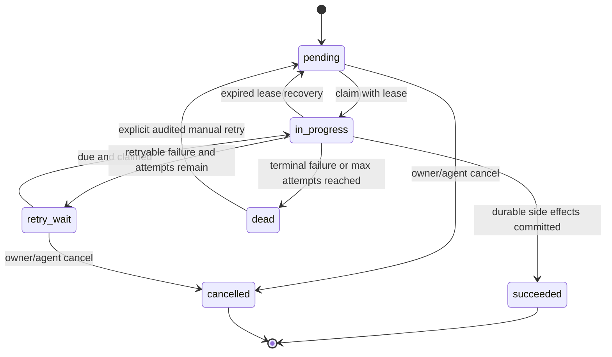

# DESIGN-005 Database and migration contract

This annex is normative for PHASE-004. Field names, ownership, constraints, indexes, migration order and rollback rules below must be implemented as written unless DESIGN-005 is amended and re-approved.

## 1. Database ownership

- One PostgreSQL database.
- Exactly two application schemas: `gateway` and `bot`.
- `gateway` owns BrowserBridge control, social identities, collection/media jobs, Drive assets, worker state, agent policy and audit.
- `bot` owns Mezon identities, delivery state, reactions, moderation, sent messages and send jobs.
- `public` contains compatibility views and renamed legacy tables only during the migration window. No PHASE-004 runtime writes target `public`.
- Versioned DDL lives under planned directory `database/migrations/` and is executed only by `tools/migrate_db.mjs` before server/worker/bot startup.
- `server/internal/store.OpenPostgres` verifies the minimum schema version and never creates/changes tables. `bot/src/store.js` never runs DDL.
- Application code always uses schema-qualified names. Do not rely on `search_path` for ownership.

## 2. Type conventions

| Concern | Contract |
| --- | --- |
| Existing entity IDs | Preserve current `BIGINT` values exactly |
| New job/session/event IDs | Application-generated UUID v4 stored as `UUID`; no PostgreSQL extension required |
| Time | `TIMESTAMPTZ`, UTC at application boundary, `now()` defaults |
| Provider identifiers | `TEXT`; never cast to integer |
| Status/type enums | `TEXT` with named `CHECK` constraints, not PostgreSQL enum types, to keep migrations reversible |
| Metadata | `JSONB NOT NULL DEFAULT '{}'::jsonb`; secrets and raw cookies forbidden |
| Error message | Stable `error_code` plus redacted `error_summary` limited to 1,000 characters in application validation |
| Updated timestamp | Application writes `updated_at = now()` in every mutation; no trigger in first implementation |
| Soft deletion | State/timestamp columns; no automatic deletion of assets or provider files |

Allowed platforms in PHASE-004 are exactly `tiktok`, `instagram`, and `facebook`.

## 3. Gateway schema

### 3.1 `gateway.schema_migrations`

| Column | Type / nullability | Default / constraint |
| --- | --- | --- |
| `version` | `TEXT NOT NULL` | primary key; migration filename prefix |
| `checksum_sha256` | `TEXT NOT NULL` | 64 lowercase hex characters |
| `applied_at` | `TIMESTAMPTZ NOT NULL` | `now()` |
| `execution_ms` | `BIGINT NOT NULL` | `>= 0` |

Runner takes `pg_advisory_lock(hashtext('browserbridge-schema-migration'))`, rejects a changed checksum for an applied version, runs each migration in a transaction, records it, then releases the lock.

Migration CLI contract:

- `rtk node tools/migrate_db.mjs --plan`: read-only list of current/applied/pending versions and legacy row counts.
- `rtk node tools/migrate_db.mjs --apply`: acquire lock and apply pending migrations.
- `rtk node tools/migrate_db.mjs --verify`: run schema/count/orphan/index/version checks without changing data.
- `--apply --verify` is the stack/deployment path. Unknown flags, checksum drift, partial version or unexpected legacy media rows fail non-zero.

### 3.2 `gateway.social_users`

This preserves current social user IDs and adds explicit scheduling/error state.

| Column | Type / nullability | Default / constraint |
| --- | --- | --- |
| `id` | `BIGINT NOT NULL` | primary key; preserve legacy ID; sequence-owned after backfill |
| `platform` | `TEXT NOT NULL` | check allowed platform |
| `source_user_id` | `TEXT NOT NULL` | non-empty |
| `username` | `TEXT NOT NULL` | `''` |
| `display_name` | `TEXT NOT NULL` | `''` |
| `profile_url` | `TEXT NOT NULL` | `''`; HTTP(S) validation in application |
| `avatar_url` | `TEXT NOT NULL` | `''` |
| `metadata` | `JSONB NOT NULL` | `'{}'` |
| `last_collected_at` | `TIMESTAMPTZ NULL` | following/profile discovery timestamp |
| `last_scraped_at` | `TIMESTAMPTZ NULL` | last completed profile crawl |
| `next_scrape_at` | `TIMESTAMPTZ NULL` | null means immediately eligible |
| `consecutive_failure_count` | `INTEGER NOT NULL` | `0`, check `>= 0` |
| `last_error_code` | `TEXT NOT NULL` | `''` |
| `last_error_summary` | `TEXT NOT NULL` | `''` |
| `created_at` | `TIMESTAMPTZ NOT NULL` | `now()` |
| `updated_at` | `TIMESTAMPTZ NOT NULL` | `now()` |

Constraints and indexes:

- Unique `(platform, source_user_id)`.
- Index `(platform, next_scrape_at, last_scraped_at, updated_at)` for due users.
- Index `(platform, lower(username))` for agent search.
- Legacy `scrape_claim_id` and `scrape_claimed_at` are not part of the final table; claims move to `gateway.collector_jobs`.

#### Owner-accepted collector gap between TICKET-008 and TICKET-009

Dropping the legacy claim columns in `0001` breaks `nextSocialUsersForScrape`
(`bot/src/store.js:301-331`), which is the only claim mechanism the media worker has until
`gateway.collector_jobs` arrives in `0005`. The consequences were presented to the owner,
who chose to accept the outage rather than retain the columns temporarily or merge
TICKET-009 into TICKET-008.

Therefore, between TICKET-008 cutover and TICKET-009 completion:

- `bot/src/media-worker-core.js:27` cannot claim social users. The media worker is
  non-functional.
- `tools/verify_worker_db_flow.mjs` and `tools/verify_social_once_flow.mjs` cannot pass.
- `scripts/doctor.sh` reports failure at those two steps by design.
- TICKET-008 acceptance criteria and verification plan were amended to exclude the two
  worker verifiers. See that ticket's `Owner-accepted collector outage` section.

TICKET-009 is therefore not optional follow-up work; it is the repair for a deliberate
outage. Live social collection must not be attempted between the two tickets.

### 3.3 `gateway.collector_jobs`

One row represents one bounded following sync or one profile-media crawl.

| Column | Type / nullability | Default / constraint |
| --- | --- | --- |
| `id` | `UUID NOT NULL` | primary key; supplied by caller |
| `kind` | `TEXT NOT NULL` | `following_sync` or `profile_media` |
| `platform` | `TEXT NOT NULL` | allowed platform check |
| `social_user_id` | `BIGINT NULL` | FK `gateway.social_users(id) ON DELETE SET NULL`; required for `profile_media` |
| `source_user_id` | `TEXT NOT NULL` | `''`; copied stable target identity |
| `profile_url` | `TEXT NOT NULL` | `''` |
| `status` | `TEXT NOT NULL` | `pending`; allowed job state check |
| `priority` | `SMALLINT NOT NULL` | `100`; range `0..1000`, lower runs first |
| `cursor` | `JSONB NOT NULL` | `'{}'`; platform pagination/scroll cursor only |
| `limits` | `JSONB NOT NULL` | required normalized limits snapshot |
| `attempt_count` | `INTEGER NOT NULL` | `0`, check `>= 0` |
| `max_attempts` | `INTEGER NOT NULL` | `5`, range `1..20` |
| `next_attempt_at` | `TIMESTAMPTZ NOT NULL` | `now()` |
| `claimed_by` | `TEXT NOT NULL` | `''` worker ID |
| `claim_token` | `UUID NULL` | changes on every claim |
| `claim_expires_at` | `TIMESTAMPTZ NULL` | lease deadline |
| `requested_by_agent_id` | `TEXT NOT NULL` | `'scheduler'`; logical agent/service ID |
| `idempotency_key` | `TEXT NOT NULL` | caller key, max 128 characters |
| `last_error_code` | `TEXT NOT NULL` | `''` |
| `last_error_summary` | `TEXT NOT NULL` | `''` |
| `started_at` | `TIMESTAMPTZ NULL` | first claim time |
| `completed_at` | `TIMESTAMPTZ NULL` | success/dead/cancelled time |
| `created_at` | `TIMESTAMPTZ NOT NULL` | `now()` |
| `updated_at` | `TIMESTAMPTZ NOT NULL` | `now()` |

Constraints and indexes:

- Check `kind = 'profile_media'` requires `social_user_id IS NOT NULL`.
- Unique `(requested_by_agent_id, idempotency_key)` where `idempotency_key <> ''`.
- Claim index `(status, next_attempt_at, priority, created_at)` where status in `pending`, `retry_wait`.
- Target index `(platform, source_user_id, created_at DESC)`.
- Active dedup unique index `(kind, platform, source_user_id)` where status in `pending`, `in_progress`, `retry_wait` and `source_user_id <> ''`.

### 3.4 `gateway.media_assets`

This is the durable source of truth for uploaded provider media. Bot-specific archive/post fields are moved to `bot.media_delivery_state`.

| Column | Type / nullability | Default / constraint |
| --- | --- | --- |
| `id` | `BIGINT NOT NULL` | primary key; preserve legacy ID; sequence-owned after backfill |
| `platform` | `TEXT NOT NULL` | allowed platform check |
| `source_user_id` | `TEXT NOT NULL` | non-empty |
| `source_username` | `TEXT NOT NULL` | `''` |
| `media_id` | `TEXT NOT NULL` | stable provider/derived item ID, never a CDN URL |
| `post_id` | `TEXT NOT NULL` | `''` |
| `page_url` | `TEXT NOT NULL` | `''`; stable canonical post URL |
| `source_url` | `TEXT NOT NULL` | `''`; last browser-visible media URL, may expire |
| `media_type` | `TEXT NOT NULL` | `unknown`; check `image`, `video`, `unknown` |
| `post_type` | `TEXT NOT NULL` | `unknown`; check `single`, `carousel`, `unknown` |
| `position` | `INTEGER NOT NULL` | `0`, check `>= 0` |
| `preview_url` | `TEXT NOT NULL` | `''` |
| `drive_file_id` | `TEXT NOT NULL` | non-empty after validation |
| `drive_folder_id` | `TEXT NOT NULL` | non-empty; must equal configured fixed folder when inserted |
| `drive_link` | `TEXT NOT NULL` | `''` |
| `filename` | `TEXT NOT NULL` | non-empty |
| `mime_type` | `TEXT NOT NULL` | non-empty valid media type |
| `size_bytes` | `BIGINT NOT NULL` | `0`, check `>= 0` |
| `checksum_sha256` | `TEXT NOT NULL` | `''` or 64 lowercase hex |
| `metadata` | `JSONB NOT NULL` | `'{}'`; normalized extractor metadata only |
| `uploaded_at` | `TIMESTAMPTZ NOT NULL` | `now()` |
| `created_at` | `TIMESTAMPTZ NOT NULL` | `now()` |
| `updated_at` | `TIMESTAMPTZ NOT NULL` | `now()` |

Constraints and indexes:

- Unique `(platform, source_user_id, media_id)`.
- Unique `drive_file_id`.
- Index `(platform, source_user_id, uploaded_at DESC)`.
- Index `(post_id, position)` where `post_id <> ''`.
- No automatic `ON DELETE CASCADE` from this table to bot history. Asset deletion is a separate approved workflow.

#### `drive_folder_id` is owned by TICKET-008, not TICKET-009

`drive_folder_id` is `NOT NULL` and must be non-empty, but
`server/internal/store/postgres.go:207-228` does not write it. If TICKET-008 created the
column while leaving folder tracking to TICKET-009, every `POST /v1/media/transfers` would
fail a `NOT NULL` violation immediately after cutover.

The owner therefore approved pulling the minimum folder-tracking change into TICKET-008:

- `store.MediaAsset` gains `DriveFolderID`, and `SaveMediaAsset` writes it.
- `handleMediaTransfer` passes the configured `s.driveFolder` value.
- A request that would insert an empty `drive_folder_id` is rejected with `503` rather than
  persisting an asset with unknown provenance.

TICKET-009 still owns the durable job-side folder snapshot in
`gateway.media_download_jobs.drive_folder_id` and the reconciliation of conflicting
request-level folders.

#### `bot.media_delivery_state` row creation

`gateway.media_assets` is written by the Go gateway while
`bot.media_delivery_state` is read by the Node bot, so an asset inserted without a matching
delivery row would never become eligible for posting. `SaveMediaAsset` must insert both
rows in one transaction, using `ON CONFLICT (media_asset_id) DO NOTHING` for the delivery
row so repeated upserts stay idempotent.

### 3.5 `gateway.media_download_jobs`

One row represents acquisition and Drive persistence for one normalized media item.

| Column | Type / nullability | Default / constraint |
| --- | --- | --- |
| `id` | `UUID NOT NULL` | primary key |
| `collector_job_id` | `UUID NULL` | FK collector job `ON DELETE SET NULL` |
| `social_user_id` | `BIGINT NULL` | FK social user `ON DELETE SET NULL` |
| `media_asset_id` | `BIGINT NULL` | unique FK asset `ON DELETE RESTRICT`; set on success |
| `platform` | `TEXT NOT NULL` | allowed platform check |
| `source_user_id` | `TEXT NOT NULL` | non-empty |
| `source_username` | `TEXT NOT NULL` | `''` |
| `media_id` | `TEXT NOT NULL` | stable identity, non-empty |
| `post_id` | `TEXT NOT NULL` | `''` |
| `page_url` | `TEXT NOT NULL` | `''`; used for re-extraction |
| `source_url` | `TEXT NOT NULL` | browser-visible candidate URL |
| `preview_url` | `TEXT NOT NULL` | `''` |
| `media_type` | `TEXT NOT NULL` | image/video/unknown check |
| `post_type` | `TEXT NOT NULL` | single/carousel/unknown check |
| `position` | `INTEGER NOT NULL` | `0`, check `>= 0` |
| `mime_type` | `TEXT NOT NULL` | `application/octet-stream` until validated |
| `filename` | `TEXT NOT NULL` | stable sanitized name |
| `status` | `TEXT NOT NULL` | `pending`; allowed media job state check |
| `stage` | `TEXT NOT NULL` | `queued`; stage check |
| `priority` | `SMALLINT NOT NULL` | `100`, range `0..1000` |
| `attempt_count` | `INTEGER NOT NULL` | `0` |
| `max_attempts` | `INTEGER NOT NULL` | `5`, range `1..20` |
| `next_attempt_at` | `TIMESTAMPTZ NOT NULL` | `now()` |
| `claimed_by` | `TEXT NOT NULL` | `''` |
| `claim_token` | `UUID NULL` | current lease token |
| `claim_expires_at` | `TIMESTAMPTZ NULL` | current lease deadline |
| `last_error_code` | `TEXT NOT NULL` | `''` |
| `last_error_summary` | `TEXT NOT NULL` | `''` |
| `requires_owner_action` | `BOOLEAN NOT NULL` | `false` |
| `drive_file_id` | `TEXT NOT NULL` | `''`; set atomically with success |
| `drive_folder_id` | `TEXT NOT NULL` | fixed folder snapshot |
| `metadata` | `JSONB NOT NULL` | `'{}'` |
| `started_at` | `TIMESTAMPTZ NULL` | first claim |
| `completed_at` | `TIMESTAMPTZ NULL` | terminal state timestamp |
| `created_at` | `TIMESTAMPTZ NOT NULL` | `now()` |
| `updated_at` | `TIMESTAMPTZ NOT NULL` | `now()` |

Allowed `stage`: `queued`, `reextract`, `download`, `upload_session`, `upload_chunks`, `persist`, `complete`.

Constraints and indexes:

- Unique `(platform, source_user_id, media_id)`.
- Check succeeded requires non-null asset ID, non-empty Drive file/folder IDs and `stage = 'complete'`.
- Check non-`in_progress` states have null claim token/expiry and empty `claimed_by`.
- Claim index `(status, next_attempt_at, priority, created_at)` where status in `pending`, `retry_wait`.
- Lease recovery index `(claim_expires_at)` where status is `in_progress`.
- Error index `(status, last_error_code, updated_at DESC)` where status in `retry_wait`, `dead`.
- Drive lookup indexes on non-empty `drive_file_id` and `drive_folder_id`.

### 3.6 `gateway.media_download_attempts`

| Column | Type / nullability | Default / constraint |
| --- | --- | --- |
| `id` | `BIGINT NOT NULL` | generated primary key |
| `media_job_id` | `UUID NOT NULL` | FK media job `ON DELETE CASCADE` |
| `attempt_no` | `INTEGER NOT NULL` | `>= 1` |
| `worker_id` | `TEXT NOT NULL` | non-empty |
| `stage` | `TEXT NOT NULL` | same stage set except complete |
| `outcome` | `TEXT NOT NULL` | `succeeded`, `retryable_failure`, `terminal_failure`, `cancelled` |
| `error_code` | `TEXT NOT NULL` | `''` on success |
| `error_summary` | `TEXT NOT NULL` | redacted, bounded |
| `http_status` | `INTEGER NULL` | range `100..599` |
| `bytes_transferred` | `BIGINT NOT NULL` | `0`, check `>= 0` |
| `retry_after_seconds` | `INTEGER NULL` | `>= 0` |
| `metadata` | `JSONB NOT NULL` | `'{}'`; no response bodies or secrets |
| `started_at` | `TIMESTAMPTZ NOT NULL` | `now()` |
| `finished_at` | `TIMESTAMPTZ NULL` | required once outcome stored |

Constraints/indexes: unique `(media_job_id, attempt_no)` and index `(media_job_id, started_at DESC)`.

### 3.7 `gateway.worker_heartbeats`

| Column | Type / nullability | Default / constraint |
| --- | --- | --- |
| `worker_id` | `TEXT NOT NULL` | primary key; UUID/name composed by process |
| `worker_type` | `TEXT NOT NULL` | `collector`, `media`, `bot`, `gateway` |
| `host` | `TEXT NOT NULL` | `''` |
| `pid` | `INTEGER NULL` | positive if present |
| `status` | `TEXT NOT NULL` | `starting`, `idle`, `running`, `stopping`, `error` |
| `current_job_id` | `UUID NULL` | logical job, no cross-domain FK |
| `started_at` | `TIMESTAMPTZ NOT NULL` | process start |
| `last_heartbeat_at` | `TIMESTAMPTZ NOT NULL` | indexed |
| `last_tick_started_at` | `TIMESTAMPTZ NULL` | |
| `last_tick_finished_at` | `TIMESTAMPTZ NULL` | |
| `last_error_code` | `TEXT NOT NULL` | `''` |
| `last_error_summary` | `TEXT NOT NULL` | `''`, redacted |
| `counters` | `JSONB NOT NULL` | `'{}'`; users/media/jobs counts |
| `updated_at` | `TIMESTAMPTZ NOT NULL` | `now()` |

API treats a heartbeat older than `3 * GATEWAY_WORKER_HEARTBEAT_SECONDS` as `stale` without rewriting the stored status.

## 4. Bot schema

### 4.1 `bot.mezon_users`

Preserve current columns and primary key: `mezon_user_id TEXT`, `username`, `display_name`, `first_seen_at`, `last_seen_at`, `created_at`, `updated_at`.

### 4.2 `bot.media_delivery_state`

Moves all bot-specific columns out of legacy `media_assets`.

| Column | Type / nullability | Default / constraint |
| --- | --- | --- |
| `media_asset_id` | `BIGINT NOT NULL` | primary key; FK `gateway.media_assets(id) ON DELETE RESTRICT` |
| `archived_at` | `TIMESTAMPTZ NULL` | |
| `archive_reason` | `TEXT NOT NULL` | `''` |
| `last_posted_at` | `TIMESTAMPTZ NULL` | |
| `post_count` | `INTEGER NOT NULL` | `0`, check `>= 0` |
| `posting_claim_token` | `UUID NULL` | |
| `posting_claimed_by` | `TEXT NOT NULL` | `''` |
| `posting_claim_expires_at` | `TIMESTAMPTZ NULL` | |
| `created_at` | `TIMESTAMPTZ NOT NULL` | `now()` |
| `updated_at` | `TIMESTAMPTZ NOT NULL` | `now()` |

Queue index: `(archived_at, posting_claim_expires_at, last_posted_at, media_asset_id)`.

### 4.3 Existing bot history tables

| Target table | Preserved columns and changes |
| --- | --- |
| `bot.media_reactions` | Preserve composite PK `(media_asset_id, mezon_user_id)`, reaction check, message/channel/timestamps. Cross-schema asset FK uses `ON DELETE RESTRICT`; Mezon FK uses `ON DELETE CASCADE`. |
| `bot.media_archives` | Preserve `id`, asset/admin/reason/message/channel/created. Add FK from admin user to `bot.mezon_users`; asset delete restricted. |
| `bot.media_posts` | Rename/backfill `public.bot_media_posts`; preserve `id`, asset/channel/message/posted_by/created; unique `(channel_id, message_id)`; asset delete restricted. |
| `bot.event_dedup` | Rename/backfill current dedup rows; `event_id` PK, type, expiry, created; expiry index. |

### 4.4 `bot.send_jobs`

| Column | Type / nullability | Default / constraint |
| --- | --- | --- |
| `id` | `UUID NOT NULL` | primary key |
| `media_asset_id` | `BIGINT NULL` | FK gateway asset, null means choose next eligible at claim time |
| `channel_id` | `TEXT NOT NULL` | non-empty |
| `trigger` | `TEXT NOT NULL` | `scheduler`, `command`, `agent` |
| `requested_by` | `TEXT NOT NULL` | service/Mezon/agent ID |
| `idempotency_key` | `TEXT NOT NULL` | non-empty, max 128 |
| `status` | `TEXT NOT NULL` | common job states |
| `attempt_count` / `max_attempts` | `INTEGER NOT NULL` | `0` / `3` |
| `next_attempt_at` | `TIMESTAMPTZ NOT NULL` | `now()` |
| `claim_token` / `claim_expires_at` | `UUID NULL` / `TIMESTAMPTZ NULL` | lease |
| `claimed_by` | `TEXT NOT NULL` | `''` worker ID |
| `message_id` | `TEXT NOT NULL` | `''`; set on success |
| `last_error_code` / `last_error_summary` | `TEXT NOT NULL` | `''` |
| `requires_reconciliation` | `BOOLEAN NOT NULL` | `false`; true for unknown provider outcome |
| `metadata` | `JSONB NOT NULL` | `'{}'`; provider result identifiers/counters only |
| `created_at` / `updated_at` | `TIMESTAMPTZ NOT NULL` | `now()` |
| `completed_at` | `TIMESTAMPTZ NULL` | terminal time |

Unique `(requested_by, idempotency_key)`. Claim index mirrors gateway jobs. Sending and recording `bot.media_posts` occur in one DB transaction after Mezon returns the message ID; a provider timeout with unknown outcome enters `dead` with `requires_reconciliation = true` rather than automatically sending a duplicate.

## 5. Agent policy tables

Exact fields for `gateway.agents`, `agent_sessions`, `capability_grants`, `policy_rules`, `idempotency_keys`, `audit_events`, and `operational_errors` are normative in [DESIGN-004-API](DESIGN-004-API.md). They are created by TICKET-011 migrations in the same `gateway` schema. Audit events preserve who requested/was allowed to do what; operational errors preserve where runtime work failed and link back through trace, request, job and attempt IDs.

**These tables are deferred.** [ADR-005](../../decisions/ADR-005-single-scope-api-keys-with-redis-cache.md) replaces the scoped-session model with a single `gateway.api_keys` table for the personal deployment. Migration `0006` is not scheduled. The replacement table is normative in [DESIGN-006](DESIGN-006-agent-api-key-and-read-api.md) and is applied by `0007`.

### 5.1 `gateway.api_keys`

Created by TICKET-012 migration `0007`. Single scope: a valid key grants every gateway capability.

| Column | Type / constraint |
| --- | --- |
| `label` | `TEXT PRIMARY KEY`, check `^[a-z0-9][a-z0-9_-]{1,63}$` |
| `token_hash` | `BYTEA NOT NULL UNIQUE`, check `octet_length = 32` |
| `token_suffix` | `TEXT NOT NULL`, check `char_length = 4` |
| `created_at` | `TIMESTAMPTZ NOT NULL DEFAULT now()` |
| `last_used_at` | `TIMESTAMPTZ NULL` |
| `revoked_at` | `TIMESTAMPTZ NULL` |

Partial index `api_keys_active_idx (token_hash) WHERE revoked_at IS NULL`. PostgreSQL is the source of truth; Redis holds a no-expiry derived cache keyed by hash. Only `SHA-256(token)` is persisted and plaintext never reaches PostgreSQL, Redis or a log.

## 6. Common job states

Allowed collector/media/send job states are `pending`, `in_progress`, `retry_wait`, `succeeded`, `dead`, `cancelled`.

Transition updates use `WHERE id = $id AND status = $expected AND claim_token = $token`; `rowCount != 1` means the worker lost the lease and must stop side effects.

## 7. Migration files and deployment order

| Version | Responsibility |
| --- | --- |
| `0001_create_application_schemas.sql` | Create `gateway`, `bot`, migration table and all TICKET-008 target tables without public FKs |
| `0002_backfill_legacy_tables.sql` | Copy legacy social/bot rows with preserved IDs; assert legacy `media_assets` is empty in the confirmed development environment |
| `0003_add_cross_schema_constraints.sql` | Add/validate FKs, checks and indexes after count/key verification |
| `0004_public_compatibility_views.sql` | Rename legacy tables to `_legacy_20260823`; create read-only views at old public names |
| `0005_media_job_tables.sql` | TICKET-009 durable queue/attempt/heartbeat columns and constraints, plus `gateway.collector_jobs` and removal of the legacy social claim columns |
| `0006_agent_policy_observability_tables.sql` | Deferred with TICKET-011 and ADR-004. Not scheduled |
| `0007_api_keys.sql` | TICKET-012 `gateway.api_keys` table and partial active-key index |

Deployment sequence:

1. Stop server, worker and bot; record preflight counts for all current public tables. A backup is optional for the confirmed disposable dev DB but mandatory if any table is non-empty.
2. Require `DATABASE_URL`. `GOOGLE_DRIVE_FOLDER_ID` is required before the social worker/server restart, not to create empty target tables.
3. Acquire advisory lock and run `0001`.
4. Run `0002` in one transaction. Preserve any social/bot rows and IDs. Assert `public.media_assets` count is zero; if it is not zero, abort with `LEGACY_MEDIA_RECONCILIATION_REQUIRED` instead of assigning an unverified folder ID.
5. Verify counts, unique keys, min/max IDs and orphan checks. Abort before cutover on any mismatch.
6. Run `0003` and reset all sequences using `setval(..., max(id), true)`.
7. Run `0004`; old names become read-only compatibility views during the dev cutover. They may be removed only in a later cleanup ticket.
8. Deploy schema-qualified code. Server startup verifies minimum version; stack refuses partial versions.
9. Run the migration and bot DB verifiers twice. Do **not** run the worker verifiers or start the live worker: the collector claim path is intentionally broken until TICKET-009 (see §3.2). Proceed directly to TICKET-009.
10. Keep legacy tables for at least seven days and one successful live UAT. Cleanup is a separate destructive ticket. Because the collector is out of service until TICKET-009, the live UAT clock starts after TICKET-009, not after this migration.

## 8. Backfill verification queries

The migration verifier must fail unless all are true:

- Legacy and target row counts match for every migrated table.
- `count(*) = count(DISTINCT (platform, source_user_id))` for social users.
- `count(*) = count(DISTINCT (platform, source_user_id, media_id))` for assets.
- Every bot reaction/archive/post/delivery row resolves to a gateway asset.
- Every reaction resolves to a bot Mezon user.
- Target min/max IDs equal legacy min/max IDs when table is non-empty.
- Legacy media asset count is zero for this development migration. Future uploaded target assets must have non-empty `drive_file_id` and `drive_folder_id`.
- No target runtime table is owned by `public` and no application query is unqualified.

The verifier writes counts/check results only; it must not print URLs, metadata, usernames or secrets.

## 9. Rollback

### Before PHASE-004 writes are enabled

Stop new processes, drop compatibility views, rename legacy tables back to original names, deploy previous binaries. Target schemas remain intact for investigation.

### After PHASE-004 writes are enabled

Automatic rollback is forbidden because it could lose new jobs/assets/reactions. Use this controlled path:

1. Stop all writers and take a full database backup.
2. Run a reviewed reverse-sync that upserts new target rows into legacy tables, including joining `gateway.media_assets` with `bot.media_delivery_state` into legacy `media_assets` shape.
3. Re-run count/orphan checks in both directions.
4. Only then replace views with legacy tables and deploy previous binaries.

Dropping either schema, legacy tables, media rows or Drive files is never part of rollback. Because the owner confirmed no existing Drive media, no Drive parent lookup/backfill client is required in TICKET-008.

## 10. Retention and cleanup

- `gateway.media_assets`, `bot.media_posts`, reactions and archives: retained until explicit owner deletion policy.
- Succeeded media jobs and attempts: retain 90 days after `completed_at`; asset remains.
- Dead media jobs: retain 365 days; never auto-delete while `requires_owner_action = true`.
- Collector jobs: retain 90 days.
- Worker heartbeat rows: retain latest row per worker ID; prune rows not seen for 30 days.
- Idempotency records: 24 hours by default.
- Audit events: 365 days by default.
- Operational error events: resolved rows retain 180 days by default; unresolved rows with `owner_action_required = true` are never automatically deleted.
- Cleanup runs in bounded batches of 500 rows, records an audit summary, and never deletes Drive files.

## 11. Database test contract

- `migrate-empty`: migrate empty DB to latest.
- `migrate-legacy`: seed exact current public DDL/data, migrate, compare all invariants.
- `migrate-idempotent`: run latest migration twice; second run makes no changes.
- `migrate-lock`: concurrent runner proves only one applies versions.
- `schema-qualification`: static check rejects unqualified application table names.
- `delivery-state-pairing`: inserting a `gateway.media_assets` row creates exactly one `bot.media_delivery_state` row in the same transaction and repeated upserts do not duplicate it.
- `drive-folder-required`: an asset insert with an empty `drive_folder_id` is rejected before it reaches PostgreSQL.
- `claim-race`: two workers claim each job at most once with `FOR UPDATE SKIP LOCKED`. **TICKET-009 only**; not runnable after TICKET-008 because the claim path is intentionally absent.
- `lease-recovery`: expired lease returns to pending once and old token cannot commit. **TICKET-009 only**.
- `cross-schema-bot`: send/reaction/archive flow resolves gateway assets and preserves identities.
- `api-key-lifecycle`: **TICKET-012 only**; issue stores only a 32-byte hash and 4-character suffix, revoke sets `revoked_at`, and the partial active index is used for lookup.
- `error-correlation`: **deferred with TICKET-011**.
- `error-retention`: **deferred with TICKET-011**.
- `rollback-prewrite`: compatibility cutover can return to legacy names before writes.
