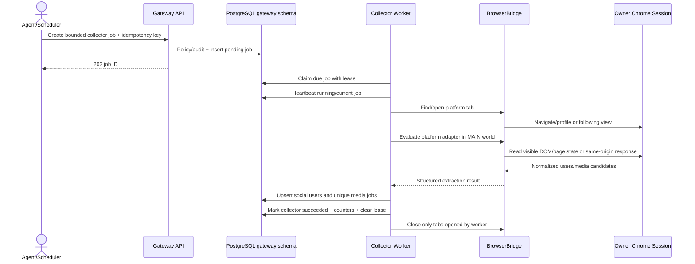
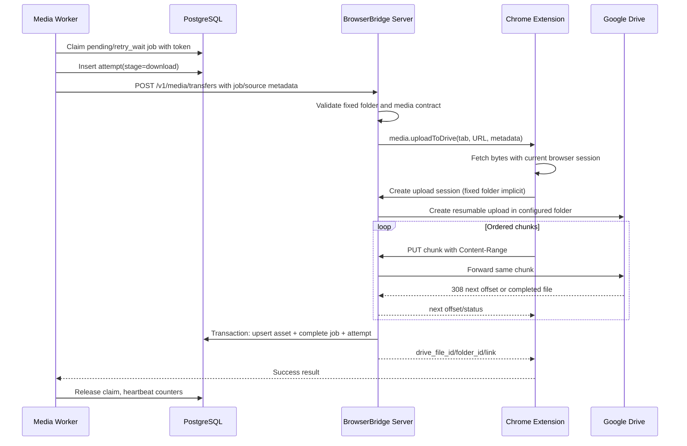
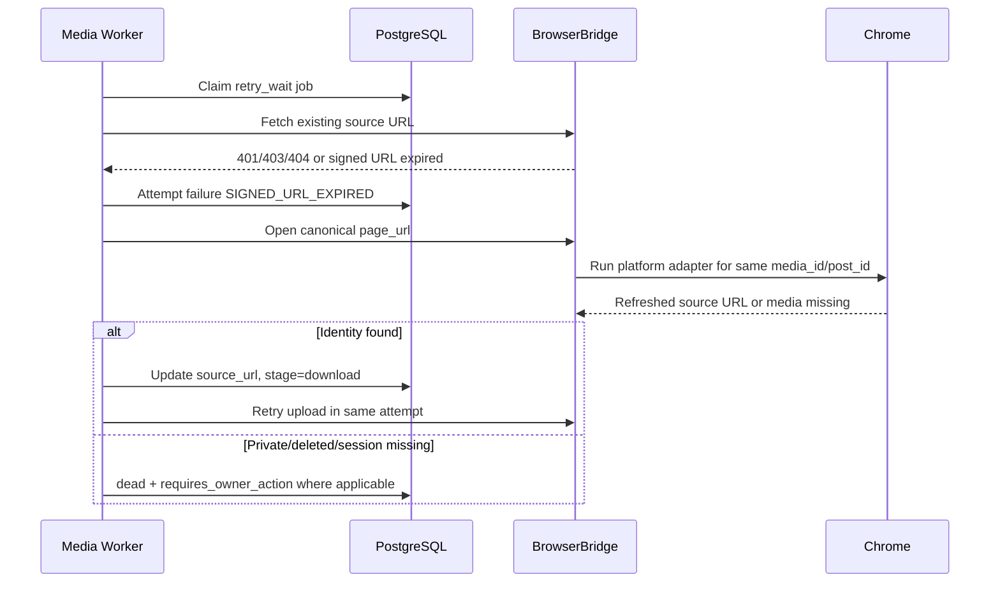
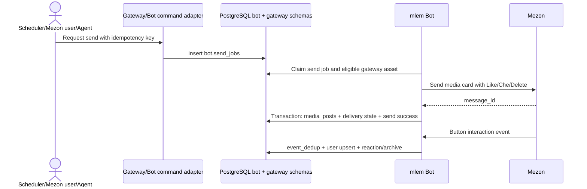

# DESIGN-005 Runtime, failure, and platform flow contract

This annex defines the normative collector/media worker behavior for TikTok, Instagram and Facebook.

## 1. Runtime components

```text
Agent / scheduler
       |
       v
Gateway API and policy
       |
       +--> gateway.collector_jobs --> Collector worker --> BrowserBridge --> Chrome
       |                                      |
       |                                      v
       |                           gateway.media_download_jobs
       |                                      |
       +--> status/audit <---------- Media worker --> chunk upload --> Google Drive
                                              |
                                              v
                                    gateway.media_assets
                                              |
                                              v
                                      bot.send_jobs --> Mezon
```

The extension owns the logged-in browser session. The gateway and workers never receive social cookies, CSRF tokens, device IDs or captured request headers. Raw media bytes transit extension -> authenticated gateway chunks -> Drive and are not written to local disk.

## 2. Collector job flow



Rules:

1. `following_sync` starts only from an already connected tab for the platform account. It never performs automated login.
2. `profile_media` opens one profile at a time, waits for readiness, then scrolls/paginates within configured limits.
3. Collector writes normalized identities/jobs in one transaction per extracted page/batch, then persists cursor.
4. Cursor advances only after the batch transaction commits. Retrying a page is safe because unique keys deduplicate users/media.
5. A collector success means discovery/enqueue completed, not that every media upload succeeded.
6. A tab opened by the worker is closed in `finally`; an owner tab selected for following sync is never closed.

## 3. Normalized identity contract

Each extracted media item represents one downloadable image or video. A carousel creates one item per child and keeps order.

| Field | Rule |
| --- | --- |
| `platform` | `tiktok`, `instagram`, or `facebook` |
| `source_user_id` | Stable provider ID when visible; otherwise deterministic namespace described below |
| `source_username` | Display handle, mutable and not part of uniqueness |
| `media_id` | Stable provider child/media ID; fallback `{post_id}:item:{position}`; never CDN URL |
| `post_id` | Stable provider post/reel/video/photo ID when available |
| `page_url` | Canonical HTTP(S) post URL with tracking query removed |
| `source_url` | Best current browser-visible file URL; may be signed/temporary |
| `media_type` | `image` or `video`; `unknown` only before validation |
| `post_type` | `single` or `carousel` |
| `position` | Zero-based item order within post |
| `mime_type` | Extracted hint, then corrected from response `Content-Type` when available |
| `filename` | `{platform}-{sanitized_username}-{post_id_or_media_id}-{position}.{ext}`, max 180 bytes |
| `preview_url` | Optional cover/thumbnail, never used as identity |
| `metadata` | Caption/title dimensions/duration/extractor source; no credentials or full page state |

Canonicalization removes URL fragments and known tracking parameters but preserves provider path identity. Source URLs may be refreshed without changing `media_id` or creating another Drive file.

## 4. Platform contracts

### 4.1 TikTok

Profile URL: `https://www.tiktok.com/@{username}`.

Extraction priority:

1. Parse `__UNIVERSAL_DATA_FOR_REHYDRATION__` already present in page state.
2. Normalize video `playAddr`/`downloadAddr` URL lists, cover URL lists and image-post children.
3. Use anchors matching `/video/{id}` and visible covers only as fallback.
4. When a cover fallback is discovered, mark metadata `download_quality = 'preview'`; a later individual-post re-extraction may replace its source URL before upload.

Stable IDs:

- User: provider `id`, then `secUid`, then `username:{lowercase_handle}`.
- Video: provider video/aweme ID.
- Image post child: provider image ID when available, else `{post_id}:item:{position}`.

Following sync may use the existing same-origin `/api/user/list/` call executed in MAIN world with the page's own session. It must use fixed benign headers authored by BrowserBridge, never captured credentials, and stop at the configured page/user limit. HTTP 401/403 becomes `BROWSER_SESSION_REQUIRED`, not an attempt to manufacture signatures.

### 4.2 Instagram

Profile URL: `https://www.instagram.com/{username}/`.

Extraction priority:

1. Parse inline JSON/page state fields already present: `video_url`, `video_versions`, `display_url`, `image_versions2`, `carousel_media`, `edge_sidecar_to_children`.
2. OpenGraph metadata on canonical `/p/`, `/reel/`, or `/tv/` pages.
3. Visible `article/main` image/video DOM using `currentSrc`, `srcset` and video `poster`.

Stable IDs:

- User: `pk`/numeric ID, then `username:{lowercase_handle}`.
- Post: provider ID or shortcode.
- Carousel child: child provider ID, else `{post_id}:item:{position}`.

Following sync may use the current same-origin friendships endpoint only with headers derived from static/document-visible application metadata. It must not read/copy `x-csrftoken`, `fb_dtsg`, cookies or intercepted headers. A provider response requiring those values becomes `PLATFORM_ADAPTER_STALE` or `BROWSER_SESSION_REQUIRED` and requires adapter review/owner action.

### 4.3 Facebook

Initial scope supports owner-supplied profile/page URLs and browser-visible Following/profile feeds. It does not call private GraphQL endpoints and does not use `fb_dtsg`.

Profile URL forms: `https://www.facebook.com/{username}`, `/profile.php?id={id}`, or page URL selected by owner.

Extraction priority:

1. Canonical post anchors containing `/posts/{id}`, `/videos/{id}`, `/reel/{id}`, `story_fbid`, or `photo/?fbid={id}`.
2. Images/videos inside the same post/article container, selecting largest `srcset` candidate, `currentSrc`, video `source`, or poster.
3. OpenGraph metadata after opening an individual canonical post.
4. Embedded JSON only when already present in page source and parseable without token lookup.

Filtering excludes UI icons, avatars, emoji and tiny assets using post-container association plus minimum natural size `320x320` for images unless the post's OpenGraph image explicitly identifies it.

Stable IDs:

- User/page: numeric profile/page ID when visible; else `username:{lowercase_slug}`; final fallback `url:{sha256(canonical_profile_url)}` computed in the worker.
- Media: provider video/photo ID; else `{post_id}:item:{position}`.

Following collection uses bounded DOM scrolling of the visible Following UI. It stores only canonical profile/page URLs and visible identity fields. No hidden GraphQL request replay, token extraction or anti-bot bypass is permitted.

## 5. Bounded crawling and rate limits

Defaults are conservative and configurable within hard validation bounds:

| Setting | Default | Allowed range / rule |
| --- | --- | --- |
| `SOCIAL_MEDIA_MAX_USERS_PER_TICK` | `3` | `1..50` |
| `SOCIAL_MEDIA_MAX_MEDIA_PER_USER` | `20` | `1..200` |
| `SOCIAL_MEDIA_MAX_PAGES_PER_JOB` | `5` | `1..50` |
| `SOCIAL_MEDIA_PAGE_LOAD_WAIT_MS` | `5000` | `1000..30000` |
| `SOCIAL_MEDIA_SCROLL_WAIT_MS` | `1500` | `500..10000` |
| `SOCIAL_MEDIA_USER_COOLDOWN_SECONDS` | `21600` | minimum `300` |
| `SOCIAL_MEDIA_WORKER_CONCURRENCY` | `1` | `1..4`; default one browser profile operation |
| `SOCIAL_MEDIA_UPLOAD_CONCURRENCY` | `1` | `1..2`; ordered chunks per file remain sequential |
| `SOCIAL_MEDIA_JOB_CLAIM_TTL_SECONDS` | `1800` | `300..7200`; renewed every 60 seconds |
| `GATEWAY_WORKER_HEARTBEAT_SECONDS` | `30` | `10..300` |

Per-platform jobs execute sequentially by default in order TikTok, Instagram, Facebook. A platform 429 honors `Retry-After`; the worker does not continue rapid pagination. Platform adapters stop when max pages/items reached, cursor repeats, no new IDs appear for two consecutive scrolls, or owner disables BrowserBridge control.

## 6. Media download/upload success flow



Atomic completion transaction:

1. Lock job by ID and current claim token.
2. Upsert `gateway.media_assets` by normalized identity.
3. Reject if an existing identity points to a different non-empty Drive file ID unless explicit reconciliation mode is active.
4. Set job asset/Drive IDs, `stage = complete`, `status = succeeded`, terminal timestamp and clear lease.
5. Mark attempt succeeded.
6. Commit, then return success.

The API response is not the source of truth after timeout; the worker queries job status by ID before retrying. If job is already succeeded, it returns the existing asset and does not create another Drive file.

### Internal transfer correlation

- Worker calls `POST /v1/media/transfers` with `media_job_id`, current `claim_token`, `tab_id`, normalized identity and current source URL. It does not send a Drive folder.
- Gateway validates the job is `in_progress`, token matches, target identity matches the stored job and job folder snapshot equals configured `GOOGLE_DRIVE_FOLDER_ID`.
- Gateway creates an opaque in-memory `transfer_id` mapped to job ID/claim token and sends only that transfer ID plus media fetch metadata to the extension.
- Extension echoes `transfer_id` when creating the upload session. Database claim token never enters page MAIN world.
- Upload session stores `transfer_id`; final persistence resolves the current job/token and performs the atomic completion transaction.
- Server restart invalidates transfer/upload session IDs. Worker sees a retryable failure, queries job/asset state, then starts a fresh transfer only when no success was committed.

Internal success response:

```json
{
  "media_job_id": "5d58e790-1509-40c5-887b-e806393ccf85",
  "status": "succeeded",
  "media_asset_id": 123,
  "drive_file_id": "drive-file-id",
  "drive_folder_id": "configured-folder-id",
  "drive_link": "https://drive.google.com/file/d/.../view"
}
```

## 7. Expired URL and retry flow



Re-extraction must match the same normalized identity. It never substitutes a different item solely because the old URL failed.

## 8. Failure taxonomy

| Error code | Retry | Owner action | Notes |
| --- | --- | --- | --- |
| `BRIDGE_NOT_CONNECTED` | yes | maybe | Retry while extension reconnects |
| `CONTROL_DISABLED` | no automatic loop | yes | Dead with owner action |
| `TARGET_CLOSED` / `STALE_TAB` | yes | no | Reopen canonical page |
| `NETWORK_TIMEOUT` / `HTTP_408` | yes | no | Standard backoff |
| `HTTP_429` / `DRIVE_429` | yes | no | Respect `Retry-After` |
| `HTTP_5XX` / `DRIVE_5XX` | yes | no | Standard backoff |
| `SIGNED_URL_EXPIRED` | yes | maybe | Re-extract once per attempt |
| `UPLOAD_SESSION_EXPIRED` | yes | no | Start new Drive session only after job status confirms no prior success |
| `BROWSER_SESSION_REQUIRED` | no automatic loop | yes | Login/refresh session, then manual retry |
| `PLATFORM_ADAPTER_STALE` | no | yes | Requires code/fixture update |
| `MEDIA_PRIVATE_OR_DELETED` | no | no | Terminal dead, redacted reason |
| `INVALID_MEDIA_IDENTITY` | no | no | Adapter defect/data validation |
| `UNSUPPORTED_MIME` / `MAX_SIZE_EXCEEDED` | no | no | Terminal validation |
| `DRIVE_NOT_CONFIGURED` / `DRIVE_FOLDER_MISMATCH` | no | yes | Configuration/security invariant |
| `POLICY_DENIED` | no | yes | No provider action performed |
| `PERSIST_CONFLICT` | no | yes | Existing identity points to another Drive file; reconcile manually |
| `INTERNAL` | yes once | maybe | Redacted; repeated internal errors dead-letter |

Retryable failure formula:

`delay = min(30 * 2^(attempt_count - 1), 21600) + random(0, 30% of delay)` seconds.

- Default `max_attempts = 5`.
- Provider `Retry-After` replaces calculated delay when larger, capped at 24 hours.
- `attempt_count` increments when a claim starts, not when it is scheduled.
- Max-attempt failure becomes `dead` even if normally retryable.
- Manual retry resets `attempt_count = 0`, preserves attempt history, clears owner-action flag only when caller explicitly confirms prerequisite resolution, and writes an audit event.

## 9. Lease and crash recovery

- Claim query uses a short transaction, `FOR UPDATE SKIP LOCKED`, due statuses and ordered priority/time.
- Worker writes a UUID claim token and expiry; every state mutation compares token.
- Worker renews an active lease every 60 seconds while browser/download/upload work continues.
- Recovery task changes expired `in_progress` jobs to `pending`, clears claim fields and records `LEASE_EXPIRED` attempt outcome only if no newer token exists.
- Before restarting upload after a crash, query job/asset by normalized identity and Drive file ID. Never infer failure only from a lost HTTP response.
- In-memory Drive upload sessions may be lost on server restart. The media job remains durable and starts a fresh resumable session only after checking no asset was committed.

## 10. Fixed Drive folder contract

1. Server and media worker fail startup when social pipeline is enabled and `GOOGLE_DRIVE_FOLDER_ID` is empty.
2. Social collector/media job API never accepts arbitrary folder selection.
3. Internal extension upload-session request may echo the configured folder ID; server rejects a non-empty different value with `DRIVE_FOLDER_MISMATCH`.
4. Server passes exactly the configured ID as the Drive parent on resumable-session creation.
5. Job captures `drive_folder_id` at enqueue. Worker refuses execution if it differs from current configured folder, requiring explicit migration/requeue.
6. Completion persists Drive file/folder IDs in both job and asset.
7. No retry moves or duplicates files between folders. Folder changes require a separate owner-approved migration.

## 11. Bot delivery and interaction flow



- Bot reads Drive link/media metadata from `gateway.media_assets` and eligibility from `bot.media_delivery_state`.
- Delete remains bot archive only; it never deletes the Drive file or gateway asset.
- Like/Che uniqueness remains one reaction per Mezon user per asset.
- Agent status APIs can read post/reaction aggregates but do not expose unrelated Mezon message bodies.
- A Mezon timeout after send with unknown outcome is terminal `SEND_OUTCOME_UNKNOWN`; an agent reconciles by message/channel before retry to avoid duplicates.

## 12. Observability

Every tick updates heartbeat counters:

- collector: users discovered/upserted, profiles opened, pages processed, media candidates, jobs enqueued, duplicates, failed;
- media: claimed, succeeded, retry_wait, dead, bytes uploaded, lease recoveries;
- bot: send jobs claimed/succeeded/dead, reactions, archives.

Every owner/MCP request gets a `request_id` and a gateway-generated `trace_id`. Background collector/media/send jobs inherit that `trace_id`; scheduled jobs create one at enqueue. Gateway commands propagate the trace through the extension, worker, Drive and bot boundaries without propagating agent tokens.

Actionable failures append `gateway.operational_errors` with component, operation, stage, stable error code, redacted summary, retryability, owner-action flag and links to the relevant job/attempt/audit event. Component identifies the fault boundary: `gateway`, `mcp`, `extension`, `collector_worker`, `media_worker`, `drive`, `bot`, `mezon`, `postgres` or `scheduler`. Domain history remains canonical in collector/media/send jobs and media attempts; operational errors provide one cross-system query surface.

When a linked retry succeeds or reconciliation confirms the outcome, the service sets `resolved_at` and `resolution_code` on prior unresolved error events but never deletes or rewrites the original failure fields. A PostgreSQL outage is necessarily not persistable there, so the gateway emits the same redacted event as one-line JSON to stderr for deployment log retention.

Structured logs include `trace_id`, `request_id`, component, operation, job/attempt ID, platform, stage, attempt number and stable error code. Logs exclude tokens, cookies, authorization headers, raw page state, source URL query strings, Drive upload session URL and media bytes.

## 13. Test fixtures and UAT

- Store sanitized HTML/JSON fixtures containing no live account IDs, cookies, signed query strings or private captions.
- Per platform: single image, video, carousel, duplicate candidate, expired URL, private/deleted result and DOM/page-state fallback.
- Fake bridge verifies tab ownership/cleanup, bounded scroll, normalized identities and enqueue dedup.
- Failure E2E verifies extension disconnect, 429, Drive 5xx, lease expiry, restart after unknown completion and dead manual retry.
- Correlation E2E starts from one MCP request and proves the same trace ID appears in its audit event, job, attempt, operational error and structured fake-provider log; agent error APIs identify the failing component/stage.
- Live UAT uses one owner-visible profile per platform, maximum three media items, and deletes only test Drive files explicitly created by the UAT cleanup step.
- UAT does not require bypassing CAPTCHA, MFA, provider blocks or access restrictions.
