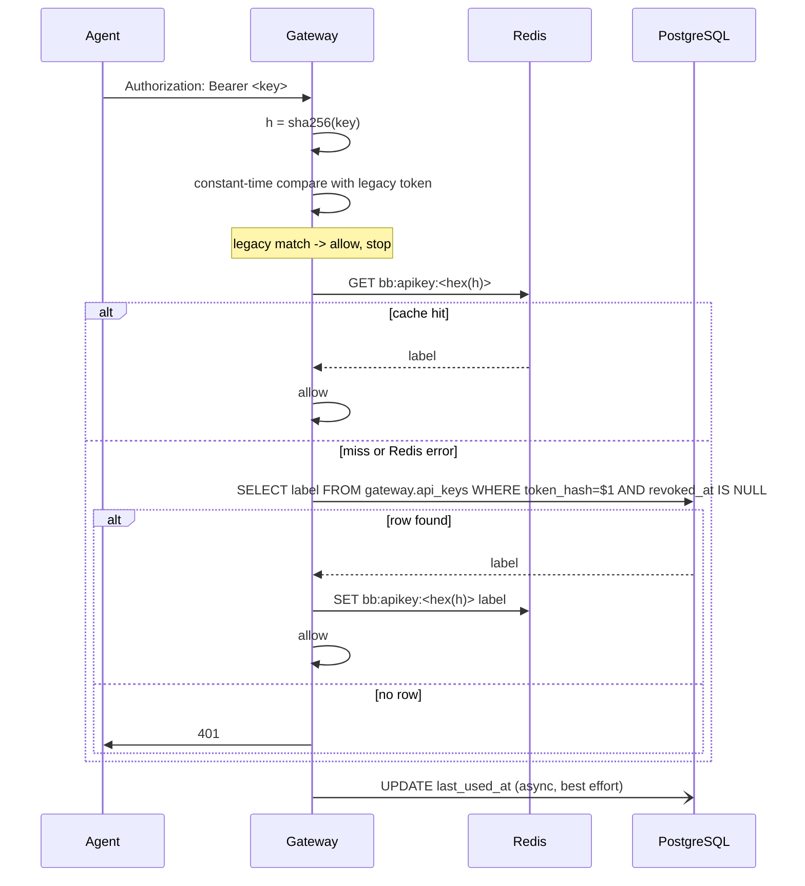

# DESIGN-006: Agent API key authentication and read API

## Status

- ID: DESIGN-006
- Status: draft
- Ticket: [TICKET-012](../tickets/TICKET-012-agent-api-key-and-read-api.md)
- Approval: pending
- Depends on: [TICKET-008](../tickets/TICKET-008-two-schema-migration.md) verified
- Normative decision: [ADR-005](../../decisions/ADR-005-single-scope-api-keys-with-redis-cache.md)

---

## 1. Context and scope

### Problem statement

An agent cannot read gateway state over HTTP. All ten current routes are browser control
(`server/internal/bridge/server.go:90-100`) and none read PostgreSQL. Answering "how many
social users are collected" or "which media failed" requires `psql` or
`node tools/media_status.mjs`.

Authentication is a single shared secret with no issue, list, rotate or revoke path
(`server/internal/bridge/server.go:580`).

### Success outcome

An agent holding one issued API key can call every gateway route, including new read
endpoints for social users, media assets and bot posts, and the owner can revoke that key
instantly from a CLI without restarting the gateway.

### Context loaded

- `docs/CONTEXT.md`
- `docs/work/BACKLOG.md`
- `docs/standards/README.md`, `QUALITY_BAR.md`, `VALIDATION.md`
- `docs/work/phases/PHASE-004-resilient-agent-gateway.md`
- `docs/work/designs/DESIGN-005-DATABASE.md`
- `docs/decisions/ADR-003`, `ADR-004`, `ADR-005`

### Brownfield scope

| Item | Detail |
| --- | --- |
| Touched files | `server/internal/bridge/server.go`, `server/internal/store/postgres.go`, `server/cmd/browser-bridge/main.go`, `scripts/doctor.sh`, `README.md` |
| New files | `server/internal/auth/apikey.go`, `server/internal/cache/resp.go`, `server/internal/bridge/agent.go`, `server/cmd/bb-apikey/main.go`, `database/migrations/0007_api_keys.sql`, `scripts/apikey.sh`, `tools/verify_agent_api.mjs` |
| Direct dependencies inspected | `server/internal/ws`, `server/internal/drive`, `bot/src/store.js` |
| Contracts affected | HTTP auth header semantics, gateway route table, `gateway` schema |
| Known unknowns | Whether the shared `dev-env` Redis enforces `requirepass`; must be probed before implementation |
| Scope expansion reason | None. Scope is fixed by ADR-005 |

### Small task exemption

- Small task exemption: no.
- Reason: adds a credential store, changes the authentication path and adds public routes.
- Impact checked: API=yes, DB=yes, Security=yes, Runtime=yes, Standards=no.

---

## 2. Design considerations and trade-offs

| Consideration | Pros | Cons | Decision |
| --- | --- | --- | --- |
| Query PostgreSQL per request, no cache | Zero new dependency, one source of truth, instant revoke, smallest code | One indexed lookup per request | rejected by owner |
| In-process map, no expiry, standalone CLI | Zero hot-path I/O | Revoke and issue require gateway restart; restart drops in-flight uploads | rejected |
| In-process map, no expiry, HTTP admin routes | Zero hot-path I/O, instant revoke, no new dependency | Admin surface on the gateway | rejected by owner |
| In-process map with TTL | Simple, bounded staleness | Cache expires, which the owner forbade | rejected by owner |
| Redis cache, no expiry, CLI mutates both stores | Zero PostgreSQL hot-path reads, instant revoke, CLI retained | Undeclared shared dependency; new failure mode; needs rehydrate | **chosen (ADR-005)** |
| `github.com/redis/go-redis/v9` | Battle-tested | Breaks the standard-library baseline for three commands | rejected |
| Minimal stdlib RESP client | Preserves baseline, ~120 lines | Must be tested carefully | **chosen** |
| Scopes on keys | Limits blast radius | More code and more decisions | rejected by owner, additive later |
| API keys may manage API keys | Convenient | Leaked key mints replacements; revoke becomes unreliable | **rejected, non-negotiable** |

---

## 3. Architecture overview

### Component responsibilities

| Component | Role |
| --- | --- |
| `gateway.api_keys` (PostgreSQL) | Source of truth: hash, suffix, lifecycle timestamps |
| Redis `bb:apikey:<hash>` (dev-env container) | Derived cache, no expiry, value is the key label |
| `server/internal/cache` | Minimal RESP client: `GET`, `SET`, `DEL`, `MSET` |
| `server/internal/auth` | Hash bearer, read cache, fall back to PostgreSQL, repopulate cache |
| `server/internal/bridge/agent.go` | New read endpoints |
| `server/cmd/bb-apikey` | Issue, list, revoke, sync. Writes PostgreSQL first, then Redis |
| `BROWSER_BRIDGE_AUTH_TOKEN` | Extension WSS credential and the only credential the CLI trusts |

### Authority boundary

```
API key        -> all /v1 routes except GET /v1/extension
legacy token   -> all /v1 routes including GET /v1/extension
API key        -> can never create or revoke an API key (no HTTP admin route exists)
```

---

## 4. Execution flow

### 4.1 Request authentication



Rules:

1. Empty or malformed bearer is rejected before any I/O.
2. Legacy token comparison uses `crypto/subtle.ConstantTimeCompare`.
3. Cache lookup is an exact key `GET`. No scan, no pattern match.
4. A Redis transport error is logged once per interval and never fails the request on its
   own; the PostgreSQL fallback decides.
5. `last_used_at` is written asynchronously and its failure never affects the response.
6. Cache values are labels, never plaintext keys.

### 4.2 Gateway startup rehydrate

The shared `dev-env` Redis runs `redis-server` with no persistence flags, so a container
restart empties the cache. At startup the gateway performs one
`SELECT token_hash, label FROM gateway.api_keys WHERE revoked_at IS NULL` and issues a
single `MSET`. Failure logs a warning and does not abort startup, because the
PostgreSQL fallback keeps authentication correct.

### 4.3 `bb-apikey issue`

1. Validate `--label` against `^[a-z0-9][a-z0-9_-]{1,63}$`.
2. Reject if the label already exists, revoked or not. Rotation is explicit: revoke, then
   issue a new label.
3. Generate 32 bytes from `crypto/rand`, hex-encode to 64 characters.
4. `INSERT INTO gateway.api_keys (label, token_hash, token_suffix)`.
5. `SET bb:apikey:<hex(hash)> <label>` with no expiry.
6. Print plaintext once to stdout, nothing else on that line.
7. If step 5 fails, print the plaintext, warn that the key is not cached, and exit non-zero
   so the operator runs `sync`. The key is already valid through the PostgreSQL fallback,
   so this is degraded, not broken.

### 4.4 `bb-apikey revoke`

1. `UPDATE gateway.api_keys SET revoked_at = now() WHERE label = $1 AND revoked_at IS NULL`.
2. If `rowCount = 0`, report `not found or already revoked` and exit non-zero.
3. `DEL bb:apikey:<hex(hash)>`.
4. **PostgreSQL first, Redis second, always.** The reverse order would let the fallback
   repopulate a key whose revocation failed to commit.
5. If step 3 fails, exit non-zero with `REDIS_INVALIDATION_FAILED` and instruct the
   operator to rerun `revoke` or `sync`. Until then the revoked key still authenticates
   from cache. This hazard is recorded in ADR-005.

### 4.5 `bb-apikey sync`

Reads all active hashes and rewrites them with one `MSET`, then deletes cached entries
whose PostgreSQL row is revoked or missing. Used after a Redis restart or a failed
invalidation.

---

## 5. API and data model design

### 5.1 Data model

Migration `0007_api_keys.sql`, applied after TICKET-008 versions `0001`-`0004`:

```sql
CREATE TABLE gateway.api_keys (
  label        TEXT PRIMARY KEY
                 CHECK (label ~ '^[a-z0-9][a-z0-9_-]{1,63}$'),
  token_hash   BYTEA NOT NULL UNIQUE
                 CHECK (octet_length(token_hash) = 32),
  token_suffix TEXT NOT NULL
                 CHECK (char_length(token_suffix) = 4),
  created_at   TIMESTAMPTZ NOT NULL DEFAULT now(),
  last_used_at TIMESTAMPTZ,
  revoked_at   TIMESTAMPTZ
);

CREATE INDEX api_keys_active_idx
  ON gateway.api_keys (token_hash)
  WHERE revoked_at IS NULL;
```

No `scope` column. ADR-005 records that adding one later is additive.

### 5.2 Cache contract

| Property | Value |
| --- | --- |
| Key | `bb:apikey:<64 lowercase hex>` |
| Value | key label |
| Expiry | none |
| Commands used | `GET`, `SET`, `DEL`, `MSET` |
| Namespace rationale | the instance is shared with the `dev-env` project |
| Plaintext in Redis | never |

### 5.3 Response envelope

Success:

```json
{ "ok": true, "data": { }, "next_cursor": "" }
```

Error:

```json
{ "ok": false, "error": { "code": "NOT_FOUND", "message": "media asset not found" } }
```

Codes: `UNAUTHORIZED` (401), `INVALID_REQUEST` (400), `NOT_FOUND` (404),
`EXTENSION_UNAVAILABLE` (503), `STORE_UNAVAILABLE` (503), `INTERNAL` (500).

Existing browser routes keep their current bodies. This envelope applies only to routes
added by this design, so no client contract is broken.

### 5.4 New read endpoints

All require a valid API key or the legacy token.

| Method | Path | Query | Notes |
| --- | --- | --- | --- |
| GET | `/v1/status/summary` | none | counts plus runtime flags and schema version |
| GET | `/v1/social/users` | `platform`, `username`, `limit`, `cursor` | `username` is a prefix match on `lower(username)` |
| GET | `/v1/social/users/{id}` | none | 404 when absent |
| GET | `/v1/media/assets` | `platform`, `source_user_id`, `media_type`, `limit`, `cursor` | |
| GET | `/v1/media/assets/{id}` | none | |
| GET | `/v1/media/assets/by-drive-file/{drive_file_id}` | none | unique per ADR-003 |
| GET | `/v1/bot/posts` | `channel_id`, `limit`, `cursor` | |

One write endpoint:

| Method | Path | Body | Notes |
| --- | --- | --- | --- |
| POST | `/v1/social/users` | platform, source_user_id, username, display_name, profile_url, avatar_url, metadata | upsert, reuses `UpsertSocialUser` |

Out of scope, blocked on TICKET-009 tables: `POST /v1/collector/jobs`,
`POST /v1/media/jobs`, `/retry`, `/cancel`, `GET /v1/media/jobs`,
`GET /v1/status/workers`.

### 5.5 Pagination

Keyset only. `cursor` is base64url of the last returned `id`. Query is
`WHERE id < $cursor ORDER BY id DESC LIMIT $limit + 1`. `limit` defaults to 50 and is
clamped to 500. A malformed cursor returns `INVALID_REQUEST`, never a silent reset.
`next_cursor` is empty on the final page.

### 5.6 `GET /v1/status/summary`

```json
{
  "ok": true,
  "data": {
    "schema_version": "0007",
    "extension_connected": true,
    "drive_configured": true,
    "drive_folder_set": true,
    "store_connected": true,
    "cache_reachable": true,
    "active_uploads": 0,
    "social_users": { "tiktok": 0, "instagram": 0, "facebook": 0 },
    "media_assets": { "tiktok": 0, "instagram": 0, "facebook": 0 },
    "media_assets_archived": 0,
    "bot_posts": 0,
    "reactions": { "like": 0, "dislike": 0 }
  }
}
```

`cache_reachable` makes the accepted Redis dependency observable rather than silent.

### 5.7 New store methods

Added to `server/internal/store/postgres.go`, all schema-qualified:

```go
StatusSummary(ctx) (Summary, error)
ListSocialUsers(ctx, SocialUserFilter) ([]SocialUser, string, error)
GetSocialUser(ctx, id int64) (*SocialUser, error)
ListMediaAssets(ctx, MediaAssetFilter) ([]MediaAsset, string, error)
GetMediaAsset(ctx, id int64) (*MediaAsset, error)
GetMediaAssetByDriveFileID(ctx, driveFileID string) (*MediaAsset, error)
ListBotPosts(ctx, BotPostFilter) ([]BotPost, string, error)

ActiveAPIKeys(ctx) ([]APIKeyHash, error)
LookupAPIKey(ctx, hash []byte) (label string, found bool, err error)
InsertAPIKey(ctx, label string, hash []byte, suffix string) error
RevokeAPIKey(ctx, label string) (hash []byte, ok bool, err error)
ListAPIKeys(ctx) ([]APIKeyInfo, error)
TouchAPIKey(ctx, label string) error
```

`ListAPIKeys` returns label, suffix and timestamps only. No hash leaves the process.

---

## 6. Security and authorization

| Concern | Rule |
| --- | --- |
| Key material | 32 bytes from `crypto/rand`, hex-encoded; only `SHA-256` persisted |
| Plaintext lifetime | printed once to stdout; never logged, never written to a file, never in Redis |
| Legacy token compare | `crypto/subtle.ConstantTimeCompare` |
| Key hash compare | exact map or index lookup on a SHA-256 digest; preimage resistance replaces constant-time iteration |
| Privilege escalation | no HTTP route creates or revokes keys; the CLI requires local PostgreSQL access |
| Extension WSS | `GET /v1/extension` accepts the legacy token only |
| Bind address | unchanged `127.0.0.1:8788` (`server/cmd/browser-bridge/main.go:24`) |
| Error bodies | never echo the bearer, a hash, a Drive resumable URL or a database error string |
| Metadata exposure | `metadata` is extractor output; an allowlist strips any key matching `cookie`, `token`, `auth`, `secret`, `session` before serialising |
| Blast radius | accepted: one key grants `POST /v1/runtime/evaluate`. Recorded in ADR-005 |
| Redis exposure | accepted: a shared instance stores label-by-hash entries. No plaintext, no PII |
| Input validation | `limit` clamped, `cursor` strictly decoded, `platform` restricted to `tiktok\|instagram\|facebook`, `id` parsed as int64, `drive_file_id` length-bounded |

---

## 7. Implementation and verification plan

### Impacted areas

- Code: gateway auth path, new cache and auth packages, new agent handler file, store
  extension, new CLI binary, one migration, one shell wrapper, one verifier.
- Product behavior: agents gain read access and revocable credentials.
- API/contracts: eight new routes; existing route semantics unchanged.
- Data/schema: one new `gateway` table.
- Security/auth: `authorizedHTTP` accepts a second credential type.
- Deployment/runtime: new `REDIS_URL` env var; new startup rehydrate step.
- Docs: API, ARCHITECTURE, ERD, SDD, CONTEXT, README.

### Configuration

| Variable | Default | Required |
| --- | --- | --- |
| `REDIS_URL` | `redis://127.0.0.1:6379` | no; unset disables the cache and uses PostgreSQL only |
| `REDIS_KEY_PREFIX` | `bb:apikey:` | no |
| `DATABASE_URL` | none | yes for API keys; unset leaves legacy-token-only auth |

Unset `REDIS_URL` must remain fully functional. That keeps the accepted dependency
optional and gives `doctor.sh` a way to test the fallback path.

### Test plan

**Unit, `server/internal/cache/resp_test.go`**

- `GET`, `SET`, `DEL`, `MSET` encode and decode against a scripted TCP server.
- Nil reply, error reply, short read, connection reset and malformed length are all
  surfaced as errors, never as a false cache hit.

**Unit, `server/internal/auth/apikey_test.go`**

- issue then verify passes; revoke then verify fails.
- unknown token, empty bearer and malformed header all fail.
- legacy token still passes while the verifier is active.
- cache hit does not touch PostgreSQL (counted through a fake store).
- cache miss falls back to PostgreSQL and repopulates the cache.
- Redis transport error falls back to PostgreSQL and the request still succeeds.
- revoked key present in cache but revoked in PostgreSQL: documents the accepted hazard
  by asserting the cached path still allows it, so the behavior is deliberate and visible.
- `last_used_at` write failure does not affect the response.

**Integration, `server/internal/bridge/agent_test.go`**

- Every new route against a seeded PostgreSQL.
- Cursor round-trip; `limit` clamped at 500; malformed cursor returns `INVALID_REQUEST`.
- 401 shape with no bearer, wrong bearer and revoked bearer.
- 404 shape for missing id and missing `drive_file_id`.
- `GET /v1/extension` rejects an API key and accepts the legacy token.
- Metadata allowlist strips a planted `cookie` key.

**E2E, `tools/verify_agent_api.mjs`**

1. `bb-apikey issue --label verify-tmp`, capture plaintext.
2. Call all eight new routes; assert `ok: true`.
3. Call `POST /v1/tabs` to prove the key also drives the browser surface.
4. `bb-apikey revoke --label verify-tmp`.
5. Re-call; assert 401.
6. Assert no output line contains the plaintext key.
7. Repeat steps 1-5 with `REDIS_URL` unset to prove the PostgreSQL-only path.

**Manual**

- Probe whether the `dev-env` Redis requires `requirepass` before implementation.
- Stop the `dev-env` Redis container, confirm requests still authenticate and
  `cache_reachable` reports `false`.
- Restart it, run `bb-apikey sync`, confirm `cache_reachable` returns `true`.

**Docs review**: TICKET-012 checklist.

### Validation matrix impact

- Update required: yes.
- Rows: agent API key auth, agent read API, cache fallback behavior, revoke propagation.

### Verification results

*Fill after execution.*

---

## 8. Reconciliation plan

- Requirements docs: no change; FR-021 and NFR-012 already cover the agent surface.
- Architecture docs: update; add the cache component and the auth boundary.
- API docs: update; add eight routes and the two credential types.
- ERD docs: update; add `gateway.api_keys`.
- SDD docs: update; add startup rehydrate and the CLI.
- ADR: created as ADR-005.
- Context: update.

### Docs review checklist

- Code changed but docs unchanged reason: n/a, docs updated with the code.
- Requirements updated or not needed reason: not needed, existing FR-021/NFR-012 apply.
- Architecture updated or not needed reason: updated for the new cache dependency.
- API updated or not needed reason: updated for new routes and auth.
- ERD/data updated or not needed reason: updated for `gateway.api_keys`.
- SDD updated or not needed reason: updated for rehydrate and CLI flows.
- ADR created or not needed reason: ADR-005 created; ADR-004 deferred.
